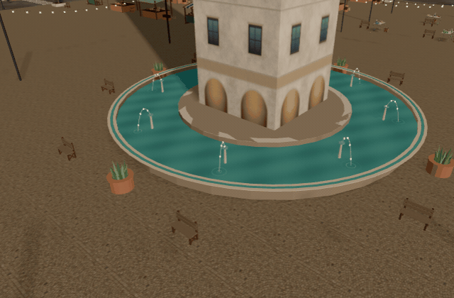

# Failures log (symptom → root cause → fix)

### Tea House structural study (2026-11-09)

The first checks proved individual slabs/treads but not a body-sized route. A 5 cm BVH route audit exposed room leaves projecting into the upper corridor and flat stair fills clipping headroom at turns. Use inward room swings, real open lobby connections and thin sloping stair soffits. Staff circulation now has two 1.25 m end gates around a 6.0 m counter, replacing the single right-hand gate described in the earlier study below. Stair B connects directly to the public lobby rather than relying on a store-room passage. The source planter and outdoor cafe sets are absent from `col_props`, so exterior clearance checks must include the actual visual Props mesh too; two cafe sets and one planter conflict with the proposed ramp. The audit applies the prescribed removals/relocation and records them as required integration work. Guards are blockers but never ground; otherwise thin rail tops appear as fake isolated standing islands.

The bar must retain a route into its staff aisle after adding stairs and a toilet/lift core. Four original 2 m counters nearly filled the 8.5 m available width, leaving end gaps too narrow for the walker. The structural proposal uses four 1.7 m counter sections and a 1.5 m end gate; the GLB geometry check raycasts the actual access passage. Shelf bays can remain 2 m wide because they do not block the counter access. The recipe and shipped mesh establish four storeys at floor datums 0.48 / 4.40 / 7.90 / 11.40 m; do not add the 4.2 m ground façade height to the raised 0.48 m finished floor. The enclosed courtyard must not be assumed to provide a street exit. See `20-tea-house-building.md`.
### SciFi EasterEgg simplification (2026-11-08)

The uploaded Sketchfab export splits one continuous colored surface into four chunks with duplicated vertices at seams. Joining objects and decimating immediately produced torn-looking facets and a larger-than-budget 16,808-triangle mesh. Welding coincident vertices at 1 micrometre after metre normalization, then recalculating normals before decimation, produces a closed 10,000-triangle surface (282 KB). Preserve the per-corner vertex colors during welding/export. The asset test checks closed topology after deduplicating exported positions so this cannot silently regress.

| # | Symptom | Root cause | Fix |
|---|---|---|---|
| 1 | `blender -b` render: `Couldn't open libEGL.so.1` | headless container lacks GL libs | `apt-get install libegl1 libgl1 ...` |
| 2 | Plan script crashed `unhashable type: list` | JSON turns tuples into lists | `tuple(bd["block"])` |
| 3 | Grey triangles / holes on pitched roofs | hip-roof faces called with eave/ridge points swapped (bow-tie quads) | pass `(E0,E1,T0,T1)` with T0 above E0 |
| 4 | Concentric rings on water/plaza/roofs in three | shadow acne (bias 0.00015 too small for a 440 m frustum) | bias −0.0004, normalBias 0.8, water receives no shadow |
| 5 | Awnings/canopies wrong colour rows | texture saved flipped; row index mapping wrong | rows are bottom-up in y-up arrays |
| 6 | Hero sign text smeared | 512x128 cell stretched over 21 m | 4 m x 1 m (4:1) board |
| 7 | Sign half dark/striped | fascia quad 2 mm in front of its frame box (z-fight) | 4 cm gap; ≥3 cm rule |
| 8 | Balcony slab at sign height | slab placed 0.8 m below window base instead of floor | `zf = zb − 0.15` |
| 9 | Rugs invisible / one triangle | meshopt 12-bit shared-exponent position filter crushed 4 cm height | patch to 20-bit separate exponents |
| 10 | Everything exported `doubleSided` | Blender default | `use_backface_culling = True` (glass exempt) |
| 11 | Press GLB 3.4 MB per building | fittings baked per building, duplicate textures | shared library + layout JSON + instancing (2.0 MB once) |
| 12 | "Built" rooms drew nothing | `useMemo` handle disposed by StrictMode effect cleanup | build in effect, keep in state |
| 13 | Cutaway opened the wrong building | picked by camera position | pick by orbit target footprint |
| 14 | Neighbour wall dithered at cut | clip plane coplanar with the wall | inset box 12 cm on party-wall sides |
| 15 | Ceiling beams look like a pergola when cut | beams sit below the clip plane | removed beams |
| 16 | 63 anchor conflicts across 77 rooms | stand approach on the wrong side (landed on counters/tables); back-row chairs sharing stand points with stools | `side=-1` for stand/chair anchors; stagger rows; checker |
| 17 | Library tables collided with armchairs | fixed positions ignoring the lounge corner | restrict table x-range near the corner |
| 18 | Poly Haven API 403 | default Python User-Agent | send `User-Agent: aiverse-city3-builder/1.0` |
| 19 | Imported asset `StructRNA removed` | `bpy.ops.object.join` deleted source objects I still referenced | store names, re-fetch by name |
| 20 | Turn clip yaw "overshoots to 250%" | measured with a hip-bone local axis | measure from the two upper-leg joints in three space |
| 21 | Body twisted 59° during turn clip | clips start 62° off Idle; I cancelled only the swing | cancel `TURN_YAW0 + yaw` |
| 22 | Heredoc in `$(...)` broke `git commit` | shell quoting | message to a file, `git commit -F` |
| 23 | Foot-slide metric "5–12× better" | fewer low-foot frames while stepping | replaced by the rigid-fit planting test (0.6 mm) |
| 24 | My unit tests failed 3 times | my expectations were wrong (hysteresis radii, `getMatrixAt` returns void, thresholds) | read the failing assertion before touching code |
| 25 | Kenney / Poly Pizza downloads | blocked (403) from the container | use Poly Haven API + Quaternius via OpenGameArt |
| Bazaar lit windows (translucent emissive pane 2-6 cm in front of upper windows, `win_glow`) | Pane mesh loaded (942 quads, correct positions, material state fine) but never visible with depth test on, even forced opaque red; visible only with depthTest off. Cause NOT found (polygonOffset, clip planes, 6 cm offset all ruled out). Reverted. Next try: emissive twin of the facade atlas, or per-bay atlas variants. |
| 26 | Agora 2 spike (2026-11-06, scratch only, stopped) | Rebuild the Lobby from CC0 kits: Quaternius Modular Sci-Fi MegaKit + Kenney Modular Space Kit + Poly Haven rock scans + scripted glue (deck, rings, hologlobe, trees). Worked: flipped rock scan under the hub, kit columns/door once textured, bloom in Blender 5 via `scene.compositing_node_group` + Glare `Type="Bloom"`. Failed: MegaKit glTFs reference textures by bare name (need `Textures/*.png` beside each .gltf, else magenta); flipped `mountainside` reads as a stump, not a spire; generic corridor kits have no floating-island hero pieces. Stopped: closing the gap to the concept needed too much hand-shaping. Current Agora kept. |
| 27 | `NameError: _principled` in a district script | `from mkit import *` skips underscore names | import it explicitly (`from mkit import _principled`) |
| 28 | Playwright `.mjs` harness: `ERR_MODULE_NOT_FOUND` | ESM ignores `NODE_PATH` | `.cjs` script with `require`, `NODE_PATH=/opt/node22/lib/node_modules` |
| 29 | 4th island never streamed at the Bazaar centre (silent) | `MAX_STREAMED=3` with four neighbours all exactly 220 m away | cap 4 (`districts.ts`) |
| 30 | Close-up screenshot showed only a wall/fin | camera at a fixed street-level point landed inside a building | check `out/<district>-plan.json` for a free spot before placing close cameras |
| 31 | Palm fronds turned to shards | decimated a geometric-leaf palm (BlendSwap #20393, 37k tris) to ~1.4k | alpha cards with a frond texture (BlendSwap #5812) |
| 32 | Festoon wires rendered as 1–2 m dark slabs (Bazaar plaza ring) | `string_lights` drew each wire segment as an axis-aligned box over the segment's bounding box: fine on an axis, a slab on any diagonal | thin crossed-quad ribbon along the segment (`details.py`) |
| 33 | USDZ party table stood on its end | `assets_kit` cleared the parent Empty, which holds USD's Y-up → Z-up rotation | for `source="usdz"` keep `matrix_world` when unparenting |
| 34 | Every party cup came out red | each USDZ holds `textures/Texture_4_ffffff.png`; importing `.usdz` directly unpacks to one shared temp dir and the importer reuses the first image with that path | unzip each USDZ to `assets/_usdx/<key>/` and import its root layer |
| 35 | Hero door detail (2026-11-06): same-colour raised panels read as one flat sheet in three (flat palette texture, no normal map, soft light) | a raised panel in the leaf colour only shows through its side faces, which are almost edge-on at street angles | 3 cm flat `cream` bead strips 2 cm proud of each panel (`doors._bead`, 8 tris per panel). Brass studs on the iron straps for the same reason (iron on iron vanished) |
| 36 | Wanted to instance the whole door, but leaf colour (6) x style (5) = 30 variants would be 90 extra draw calls | EXT_mesh_gpu_instancing needs identical mesh per node; colour is baked in the palette UV | split: colour-independent static part (frame, glass, handle, kick plate, canopy, lamp, steps, plaque) = 5 meshes under `inst_door_*` (10 primitives); leaf + 7-seg house number = bucketed in the shared palette mesh |
| 37 | Hero door detail must not reshuffle the city | `hero_ground` and `rr_` share RNG streams with interiors and sidewalk dressing; any extra draw changes every later layout and anchor | style and number come from their own `random.Random(9100+idx)`; verified `out/heroes.json` and `hero-anchors.json` byte-identical before/after |
| 38 | Playwright screenshot of City 3 timed out at the default 30 s; vite on 5391 was another agent's | swiftshader needs ~90 s per frame at this scene size; port already taken | `screenshot({timeout:180000})`, read the port vite prints (5392), 900x560 viewport, run as a background job |
| 39 | Collision checker said every point was outside / spawn ring "inside col_ground" (2026-11-06) | Moller-Trumbore `a = e1.(d x e2) = -d.n`: front face is a>0, I had it reversed; and the plaza sector quads were wound clockwise (normal down) | flipped the test; wound `i0,o0,o1,i1`. Check winding with signed volume + first-hit probes, not by eye |
| 40 | Press chairs' approach point sat inside the desk box | `add_anchor(..., side=1)` put the approach in front of the chair = on the desk | `side=-1` (approach from behind), as the cafe chairs do |
| 41 | Door path blocked by crates/plants/display tables in 21 narrow shops | templates place decor at fixed u, door bay is not centred in narrow shops | sidecar boxes are trimmed off the 1.7 m x 3 m corridor (visual props unchanged) |
| 42 | Quay wall closed the bridge landings | wall was a full ring | `quay(gaps=...)`: open for |t|<10.5 where a bridge lands; Halo also skips piers |
| 39 | City 3 walker: running at 2.7 m/s skated (planted toe slid 1.31 m/s headless), strafe/backward played the forward Walk sideways | CastFigure only blended Idle/Walk, Walk timeScale capped at 1.4x; body heading = view heading | `gait.ts` Idle/Walk/Run blend with one shared phase + measured Run stride (2.673 m/s), body heading turns toward travel, walking backpedal = Walk reversed (10-walker.md). Slip at 2.7 now 0.24-0.53 |
| 40 | Run clip would float ~9 cm | the batch bake stripped hips translation, so Run's stance drop is gone: stance toes 0.117 m vs Walk's 0.027 | lower the figure by `run.footLift` 0.088 x Run weight (planted toes 0.029-0.032, = Walk's) |
| 41 | Stance-speed measurement depends on the contact band: 1.5 cm gave Walk 1.061, 3 cm gave 0.68 (vs the bake's 1.0796) | a height band around the lowest foot height catches the swing too when wide, too few samples when narrow | calibrate the band on the clip whose speed is known (Walk: 2 cm = 1.081, 0.1%), then measure Run with the same band |
| 42 | Docs said Summer's Walk "sinks ~1.26 m per cycle" (vertical guard's reason) | stale for the shipped cast-summer.glb: Walk and Run hips tracks are constant (dy +-1 mm) | guard kept (harmless no-op, other bodies), noted in 10-walker.md; measure the GLB, not the comment |
| 43 | Agent worktree started on `main`, which has no walker (CityWalker/walker.ts/10-walker.md missing) | the walker commits live on `feat/halo-lagoon`, not merged to main | branch from the branch that has the files (`git branch -a --contains <commit>`) |

| 39 | Walker collision (2026-11-06): fuzz "inside footprint" violations on every face of every building | I used `city3-nav.json` `footprints` as the oracle, but those are LOTS (buildings are inset 4 m; stall lots are 4.6 x 3.6 vs a ~3.1 x 1.8 counter), so the bot legally stood in the margin | oracle = `tools/city3/plan.json` buildings/halls/towers (Blender frame, three z = -y), stalls as a 0.85 m-half square. Fuzz against a collision GLB generated from the same data proves nothing (circular): use the exporter's real file |
| 40 | Screenshot scenario "stopped at the wall?" cost three re-runs | my scripted run was simply too short (run 2.7 m/s x 4 s = 10.8 m, walk 1.3 x 4.2 s = 5.4 m) | compute distance = speed x time before reading a stop position as a collision |
| 41 | `tsc`: two incompatible `MeshBVH` types | bun installs three-mesh-bvh 0.8.3 (drei) and 0.9.16; `geometry.boundsTree` is typed by 0.8.3 | cast `new MeshBVH(g) as unknown as typeof g.boundsTree`; never call `disposeBoundsTree` outside CameraCollider's prototype patch (set `boundsTree = undefined`) |
| 44 | Stall goods (2026-11-06): first build put 431k instanced tris on 80 stalls | 135 baskets x 650 tris, sacks 600-700, 20-tri fruit x 25 per crate x 4 crates x 2 rows | decimate real assets to 130-260 tris, 2-layer heaps, fewer bottles / goblets / rolls: (223k after the later 2-layer heaps and smaller crates, 922 instances); still the biggest cost of the change, trim counts before adding stocks |
| 45 | Goods loaded `metal_jug` under its Poly Haven id, which the interior library also uses | `assets_kit.LIB` is keyed by name; my 300-tri budget shadowed (and a later 700) the library's version | load goods under `g_<asset>` names so the library keeps its own budget |
| 46 | Old price panel (flat red slab 1.2-1.7 m, 2 m in front of the counter) hid the goods at eye height | it was on the -y side of every stall regardless of facing | removed (draw kept in the rng stream) |
| 47 | Stall close-up screenshots showed giant baskets / a flat wall (2026-11-06) | the walk camera collider pulled the camera to the first hit of a ray cast from inside the stall box (target = stall centre) | `window.__districts.collide(false)` before placing study cameras; a Blender workbench render of `out/city3.blend` (1000x640, ~15 s) is a fast cross-check |
- 2026-11-07 Foundry industrial pass: Sketchfab `Low poly Forklift Truck` (forklift_kolos) imports lying on its side at ~10 m long (up = -x, forward = +y, axle = z after AK.load); industrial.build_forklift remaps to (-z, -y, -x) and scales (0.27, 0.215, 0.27). Check any new Sketchfab FBX-derived model with 3 ortho Workbench renders before placing it.
| 48 | Walker figure "air-walks" even though the slip numbers looked fine (2026-11-07) | the old slip harness measured foot JOINTS near their own minimum and skipped the hips guard; the shipped Walk never had a sole on the floor (Summer contact 6 % of frames, up to 8.8 cm high) | measure skinned vertices on the floor (`harness/gait_full.mjs`), and ground the figure by its lowest contact joint each frame (`grounding.ts`) |
| 49 | Remy (Mixamo FBX, Armature scale 0.003) jumped metres sideways in Walk | the root-motion cancel used the hips delta in armature units on a scaled parent | `rootMotionDelta` multiplies by the parent's scale; check any new rig's hips-parent scale |
| 50 | Headless harness: skinned vertex heights never changed with the pose | `Object3D.clone(true)` keeps the SkinnedMesh bound to the ORIGINAL skeleton | clone with `SkeletonUtils.clone` (as CastFigure does) |
| 51 | KayKit foot joints not found by name | GLTFLoader sanitizes `foot.l` to `footl` | match `^(foot|toes)\.?[lr]$` |
| 52 | Standing bots marched in place; Idle -> Walk start-up slid (2026-11-07) | the catalog clip "Idle" is a slow walk in place (ankles 0.1-0.6 m apart), not a rest pose; docs called it "a subtle sway" because only pelvis yaw was ever measured | rest in "IdleLong" (`bodies.ts` CATALOG); pinned by `tests/idle-clip.test.ts`; always measure the LEGS of a clip you call a rest pose |
| 53 | Foot lock first measured as "no effect" / sinking 4 cm (2026-11-07) | (a) the plant test read the joints' clearance in the scene frame, which ignores the grounding drop applied to the group; (b) lowering the group with `updateWorldMatrix(false, true)` does not refresh a SkinnedMesh's `bindMatrixInverse` (only `updateMatrixWorld` does), so vertices read in the same frame sat `dip` too low (the renderer's full update is fine, a harness is not) | pass the grounding drop to `FootLock.update`; use `group.updateMatrixWorld(true)` after moving a skinned figure and before reading vertices |
| 54 | Ankle-only lock still skated 0.14 m/s walking | pinning the ANKLE pivots the sole about a fixed point at heel strike and toe-off | pin the contact LANDMARKS (heel vertex, ball, toe tip) and move the foot by the pinned offset, so the foot rolls |
| 55 | Locked feet needed a leg longer than the clip's | the baked legs run at 0.98-0.999 of full extension through the whole stance (Summer's long legs on Body Block's clips) | dip the pelvis (<= 6 cm, smoothed) until each locked foot is inside 98 % reach, then re-aim every leg at its world target |
| 56 | Remy's swing toe scraped the floor at 5 m/s mid-Walk (blend rate 1.41) | the baked toes graze the floor mid-swing; not a plant, so the lock rightly ignored it | keep an unpinned foot's lowest landmark >= 1.5 cm (toe clearance) |
| 57 | Standing bot's feet "skate left-right" in City 3 (2026-11-07); in dev the idle did not play at all | the foot lock ran only above 0.25 m/s; the idle sways ~1 cm and the walker turns the body to the view on the spot with no stepping. Separately: StrictMode's mount/cleanup/mount stopped the Idle started by the actions memo (dev only), so dev checks of "standing" saw a frozen pose and proved nothing | standing hold (feet pinned in position and heading); restart Idle in the mount effect; verify standing behaviour on a production build or headless, never from a dev console alone |
| 58 | Teleported bot stood in a leg split (2026-11-07, keeper review) | the standing hold kept the pins at the old spot; the reach release re-pinned at once onto the stale offset, forever | `MAX_BODY_STEP` 0.5 m: a body that jumps further in one frame resets the lock. A first fix also dropped the correction instantly on reach release: that popped Remy's feet while turning (worst frame 19 m/s) and was reverted; measure the turn matrix (`gait_rot.mjs ROT=`) after any footLock change |
| 59 | Tea door auto-open hunted at the stand pose for ever (live only; headless passed) | align walked at the pose point with `faceHeading` = direction to the point: arriving at 1.3 m/s it overshot by 3-6 cm, turned round to go back, and never met position AND heading tolerance together | inside 0.6 m move in the POSE frame (forward/strafe/back) holding the pose heading (`alignInput`) |
| 60 | Door leaf lagged the door clip under slow frames | the controller ran on `min(delta, 0.05)`, the clip tester on raw delta: at 2-10 fps the clip ended before the leaf had moved | drive the controller with `min(delta, 0.25)`; if the one-shot has already ended, skip ahead to the step-through |
| 61 | Feet pivot on the floor during long turns on the spot | the standing hold keeps each foot up to 0.6 rad from the clip, then the foot follows the body round on the floor | turn stepping: a held foot > 10 cm or > 20 deg off the clip steps there (0.28 s, 5 cm arc), one foot at a time. NB `easeBlend` is 0 -> 1 (smoothstep): `1 - easeBlend` ran the first version backwards (jumped to the end, eased back) |
| 62 | Scout could no longer enter the Tea House once the door pilot (#33) merged | the door controller was driven only by the player's walker, but its shut-door blocker sits in the collider list EVERY walker shares; in `?agent=1` the player walker is not mounted, so the door never ticked and stayed shut | multi-actor `TeaDoorController`: `drive(s, dt, wantsForward, actorId, channel)` per walker (Scout via `clipChannel(ClipTestState)`), `tick(dt)` once per frame (`TeaDoorTicker`, or Scout's sim clock in agent mode), one session at a time (others wait outside), auto-close waits for every live actor; Scout's go_to pauses its clocks while a door holds the body |
| 63 | Radio `interact` ended `blocked` at once for Scout (live only; unit tests passed) | a session is registered with its actor only when `drive()` first runs; Scout drives only once the session holds the body, so the controller's actor-expiry tick dropped the session before the first drive (the player drives every frame, so it never showed) | `request()` registers the actor; the Scout tests now tick the controller like ScoutAgent's sim interval (mutation-checked: they fail without the fix) |
| 64 | Radio never switched on in the player's live run | the clip ran on the figure's own (raw-delta) clock and finished before the controller's clamped clock reached the contact moment, so the session ended with no flip (the same desync as row 60) | if the Interact clip has ended on its own, the contact has passed: skip ahead and flip; only ANOTHER clip taking the stage before contact aborts |
| 65 | Stand point unreachable though every unit test passed | the tests used a bare floor; the walker body is 0.4 m, the table box leaves only 0.49 m from the table edge, and my first stand point was 0.34 m off it | `tests/interactables-assets.test.ts` walks the REAL Tea House furniture collision from three sides; `check_collision.py` checks interactable stand points >= 0.45 m off boxes |
| 66 | Pilot light glowed on the antenna tip, 0.45 m above the radio | the heuristic put it on the top of the largest part; this asset's largest part is the antenna/mic mesh, not the transceiver | the pilot position is authored per prop (`pilot` in the definition, from `rooms.py`); the heuristic stays only as a fallback |
| 67 | Full `build_city.py` cannot run in this cloud box | the main checkout's gitignored inputs are stale (`tex_m/plaster002_*` missing, `assets/3dtextures/Water_002` never fetched; the HTML page has no scriptable zip link), so `mtex.py` / the build fail before the room export | generated index files patched by values derived from the same placement and flagged for a rebuild + `git diff` on a machine with the inputs (see 10-walker.md); keep new generator inputs listed in the README so a clean box can rebuild |
| 68 | The Mage gestured talking in silence; visitors left before he spoke | the keeper's `Talking` loop fired on proximity, independent of speech, and the first spoken line waited on the 64.5 MB model download | warm the engine on entering City 3 and pre-synthesize the script; `prepare()` never waits (cache, live if loaded, else the pre-rendered clip); `Talking` only while a line plays, a wave on approach |
| 69 | Greeting never spoke in dev though sound consent was granted | it held the SoundDirector it was built with; StrictMode's unmount effect disposed and re-created the director, so the greeting asked a dead one (consent `unknown`) | rebuild the greeting whenever the director instance changes; debug hooks read the live ref |
| 70 | Bartender never greeted a customer standing at the bar | a 3.2 m circle round one man covers ~2.5 m of a 12 m bar: customers stand >= 0.4 m in front of the stools, ~3 m from him at best | trigger on the zone in front of the whole counter run (or near him), hysteresis by growing the zone 1 m |
| 71 | Only the bartender's head showed above the counter | the cast is ~1.30-1.45 m tall in real-size rooms (counter 1.12 m) | a 0.35 m duckboard hidden by the counter; the cast/room scale mismatch is logged as an open decision (10-walker.md) |
| 72 | Characters were child-sized in real-size rooms (only the bartender's head cleared the counter; benches at Summer's chest) | the cast standard was Body Block's 1.30 m and every new body (KayKit, Remy, Summer) was normalised to it, while the rooms were built at real size | per-body display scale to realistic adult heights (`bodyAtScale`), registry facts scaled with it; walker run, camera rig, door reach re-derived; measured heights in 10-walker.md |

### Fountain garden and animated water (2026-11-08)

- `fountain_garden.py` builds pale stone/turquoise coping and four terracotta herb pots. `planter_positions()` is shared with `collision.py`: radius 11.7 m puts the pots outside the 10.5 m rim, with 0.54 m clearance. Pot bases embed 1 cm into paving; placing them at the water height made them float 60 cm above the visible ground. Closed planter collision cylinders are included in the shipped collision GLB.
- The dry basin was caused by `DistrictWorld` hiding resident material `water`. The legacy GLB merges basin, sea and nozzle caps in that mesh. Keep legacy water and newer separate sea hidden; render the district ocean and `FountainWater` independently. Restore cached GLB visibility on cleanup.
- `city3-fountain.json` carries generator-authored water and nozzle dimensions. Copy it from `out/` to console `public/assets/` with the GLBs. The runtime annulus sits at y=0.8, 30 cm below the original rim, with a scrolling 64x64 normal texture, eight arcs, two expanding landing rings per arc, and 32 moving highlights in one instanced draw. All water visuals stay outside collider roots. Recreate the normal texture during StrictMode effect setup so cleanup never leaves a reused, disposed texture.
- Full generator inputs are unavailable in this sandbox. The preview GLBs append only newly exported garden/detail collision to the shipped assets, preserving all original mesh/material/accessor definitions and binary data. Full rebuild was not attempted; full generator hooks are included. Avoid round-tripping the entire legacy GLB through Blender: its exporter warned about existing multi-texture samplers and vertex colours.
- Verified production console build, city3/district/camera-collision tests, Python syntax, closed collision topology, and browser views from close-up, overhead and walking height. Browser checks confirmed eight jets, changing normal offsets/highlight matrices/ring scales, basin ground query null, adjacent paving at y=0.2, and no JavaScript errors. Animation capture samples the real R3F scene at 12 steps/s. No GPU performance claim from software rendering.

### Reachable-source planter pass (2026-11-08)

- Replaced the four 16-sided fountain pots/spear leaves with Poly Haven CC0 clay pots and haworthia/gravel. Two shared meshes, 8,265 triangles per placement, original 1K PBR maps; source white ceramic container excluded. Bases at z=.19, rim z=.92, clay maximum radius .65 inside the existing .66-radius collider. Positions still come from `planter_positions()` outside the basin. Generator credits include both sources.
- Source dry runs: Poly Haven model downloads and checksums passed; BlenderKit CC0 model download/import passed but the sample expanded to 1,987,336 triangles and carried third-party texture names, so it was not used. Sketchfab search works but download returns 401; BlendSwap search works but archive page requires sign-in. OpenGameArt's Quaternius furniture ZIP passed CRC. Kenney catalog works but attempted download returned 403. Work uses the successfully retrieved Poly Haven sources.
- Full city inputs remain incomplete. `replace_glb_detail.py` swaps the garden scene root and appends the newly exported detail, remapping textures/materials/accessors while asserting every old data table and original binary prefix stays intact. Old detached garden data remains in the GLB; use a saved pre-edit base on each iteration to avoid repeated payload growth.

### Four-floor Tea House runtime integration (2026-11-09)

- The collision bake used to merge every surface into one ground-capable BVH. Keep structural ground and `noGround` blockers in separate baked meshes: window glass, guards and door leaves block movement without becoming floors. The lift pit base must be authored as a slab, while its enclosing walls remain blockers. Validate actual shipped GLBs through the production walker, with the radio table and Remy present.
- An orbit target below a floor cut can drive the camera into partition walls and hide the floor. Put the spectator target above the selected cut, and follow the walker height only while walking. Camera rays must discard clipped intersections and continue to the next visible face, even inside the same BVH mesh. Reset cut-plane state when materials/planes are recreated during development.
- A bar aisle that passes without an NPC can fail with Remy standing in it. His placement now leaves 0.87 m behind his body; both staff gates and the complete route behind him are checked with his collider present. Keep the greeting zone within the shortened 6 m counter and ignore upper-floor visitors.
- Scope this integration to its pinned pre-edit city, retaining the original binary payload. An alternate-output run must reproduce the shipping files; do not repeatedly append to the last generated output. New main-branch city asset changes require deliberately rebasing the source pin.

### Building bones, shop-46 replacement (2026-11-10)

- The server sim (`loadWorld.ts`) parses the collision GLB with a plain `GLTFLoader` (no meshopt decoder), so it reads the raw fallback index bytes. `bridge_bazaar.rewrite_indices` re-encodes only the compressed copy, so every earlier collision cut (edge-block houses) was invisible to the sim and the navmesh bin never changed. `bridge_bones.repair_fallbacks` copies the decoded indices back into the raw bytes. Do not write the raw bytes inside `rewrite_indices` for the visual GLB: its fallback region is not guaranteed to be physical and the write corrupted vertex buffers (`decode_vertex_buffer` error -2).
- Recast drops stair flights built from stacked step boxes in the navmesh bake; the collision GLB carries a 30 degree ramp prism per flight (visual keeps the steps), plus a separate landing box, or the two flights are not connected.
- A cut that tests triangle centroids against the lot rect leaves awnings, signs, planters and door steps hanging off the street wall: pad the street side by 1.5 m (`bridge_bones.FRONT_PAD`). Hero-room furniture lives in `interiors/shop-N.json` and `.col.json`; empty both or old boxes stand in the new corridors.
- Check: a route test from the street door to every room on every floor must end on the right floor (compare the last waypoint height, not only the XZ gap).

## Bones rollout, 76 market lots (2026-11-10)
- `bridge_bones.py --lots all` replaced every market lot except shop-102 (Tea House). Check: `bun run tools/city3/nav_bones_check.ts` (street door to corridor centre on each floor), 76/76 pass.
- shop-166 upper floor never connected in the navmesh. Mirroring the stair core did not help; cause not found. Replaced by a one-storey building (`FLOORS` in `bones.py`) instead of debugging. Rule: replace broken mesh, do not fight it.
- Navmesh is fragmented: start a route from a street pocket and most of the city reads "unreachable". Start route tests at the plaza (0, 0.2, 18).
- `index.json` `door` is in GLB z (`-plan y`), not plan y.
- Edge landscape vs rebaked navmesh: 698/715 yard sample points reachable from the plaza; 17 unreachable (outer rim, not investigated).
- Visual GLB 47.6 -> 57.8 MB. Dead bytes are negligible (3 unused views); growth is the uncompressed `Bones_shop*` nodes.

## Bones polish, GLB size and floor z-fight (2026-11-10)
- `bridge_bazaar`-style appends leave dead bytes and the raw `Bones_shop*` streams were uncompressed. `bridge_compact.py IN OUT [--drop-dead]` meshopt-encodes them losslessly and rebuilds the BIN from referenced spans only: 58.05 MB to 37.68 MB, every live accessor verified identical. Re-run it after every bridge script.
- Bones floors showed wood-grain stripes: the bones ground slab top (y=0.2) was coplanar with the textured `Sidewalks` ground. Fixed by lifting the visual `Bones_shop*` nodes 0.02 m (`bridge_bones.py --lift`); collision keeps the true height. Two wrong theories came first (leftover `InteriorWalls`, shadow acne); a live scene raycast found the cause.
- Merged world meshes keep collapsed (degenerate) triangles in the index and vertex buffers. Filter triangle area above 1e-4 before any coplanar or count analysis, and test the full triangle bounding box, not the centroid, because `Sidewalks` quads are huge.
- Check live scenes over CDP (`connect_over_cdp("http://localhost:9222")`), not software GL: SwiftShader shimmer reads as bugs. Debug hooks: `?world=city3&walk=1&walkDebug=1` gives `window.__walk`.
- shop-47 striped awning remnant: source mesh not in the live `Awnings` triangles; five attempts failed and the speculative `--awnings` pass was reverted. Open. Rule: replace or cover, do not hunt.
- Open: shop-46 door frame has no leaf; small dark plaques float beside several doors; roof cutaway not verified live; 17 outer-rim yard points unreachable.

- Hero door frames (`inst_door_*`, EXT_mesh_gpu_instancing) stand at the lot centre; bones put the door elsewhere on 49 of 76 lots, leaving a frame, number plaque (the "floating dark plaque") and canopy on solid wall. `bridge_bones.py --doors` zeroes the SCALE of those instances (`hide_stale_frames`), adds a plain frame + an open leaf (`Door_shop{n}`), and reads true frame centres by decoding the instance translations. The bone cut collapses leaf triangles to zero area (check areas, not counts). The studded style static part holds a closed backing slab, so studded frames are hidden on bones lots too (shop-50).

- KTX2 (PR #101): three images in `world-city3.glb` are not multiples of 4 (`interior_wall` 384x403, `landscape` 368x271, `portrait` 246x192). On S3TC/BPTC GPUs `glTexStorage2D` fails ("not multiples of 4") and the surface renders black; three only warns "ETC1S and UASTC textures should use multiple-of-four dimensions". `fix_npot_ktx2.py --source <jpeg glb>` puts the original JPEG back as a plain texture for those. Check any new KTX2 swap for NPOT sizes. Bones pipeline on the KTX2 GLB: `add_tex_material` reuses the existing texture entry (it carries `KHR_texture_basisu`); `bridge_bones.py --rebuild --no-signs` keeps shipped signs (re-running sign lettering appends duplicate PNGs).

| 2026-11-13 | Standing Summer re-stepped one foot every idle cycle (2 cm/frame, 5 cm hop) | foot lock's turn-step distance trigger (STEP_DIST 0.1 m) is below the 12-15 cm the IdleLong clip itself drifts the feet | STEP_DIST 0.2; yaw trigger unchanged; harness/idle_trace.cjs measures it (no lock slides 12-15 cm, lock 0) |
