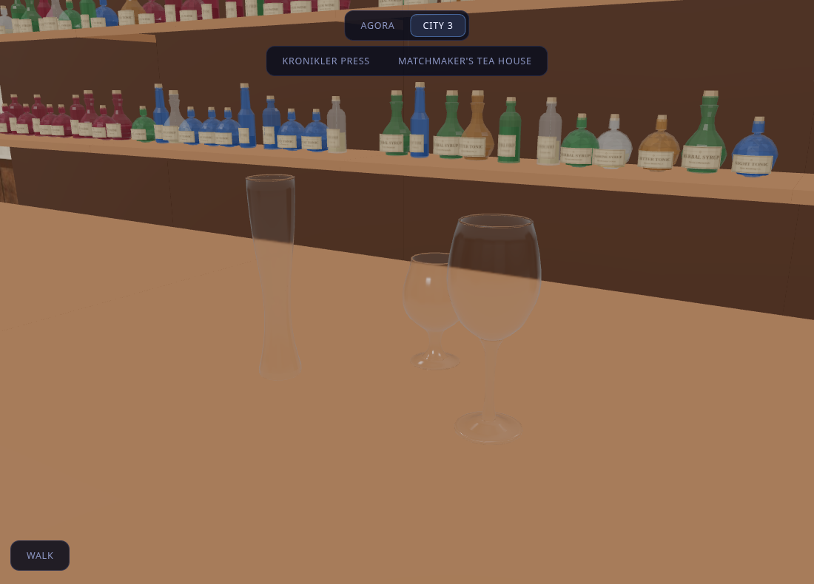

# Uploaded drinking glasses and workshop packs

The Verres FBX and OBJ uploads contain matching sets of 25 closed glass meshes. The FBX carries offline V-Ray material links; the OBJ is used as geometry-only input. Neither upload supplied an author/licence document. Checksums and selected shapes are recorded in `tools/city3/assets/verres/source-manifest.json`. The canonical OBJ is retained in `assets/verres/Verres.obj` so all 25 shapes remain available; the alternate FBX stays local.

## Replacements

`WineGlass_01`, `WaterGlass_01` and `ElinaChampagneGlass_01` replace the opaque goblets on Bazaar tables and shared café/counter sets (including the Tea House). Each set has 7,648 triangles and one shared material. Counter heights range from .15 to .265 m; Bazaar heights range from .16 to .21 m. Every glass has a hollow bowl, closed solid walls, and a grounded base.

The shader is glTF PBR: transmission 1, roughness .075, IOR 1.5 and 1.5 mm volume thickness with subtle absorption. No image textures are needed. The committed `assets/verres/drinkware.glb` provides both templates so fresh clones can rebuild without the original uploads. `rooms.py` and `goods.py` use `drinking_glasses.py`; source regeneration uses `prepare_drinking_glasses.py` through the Blender lock wrapper.

For the shipped GLBs, `bridge_drinking_glasses.py` redirects only `inst_goods_goblets` and `LIB_brass_goblets` to appended meshes. Existing instance transforms, layout JSON, other meshes/materials/accessors and original binary data remain intact. Run from saved input GLBs when iterating. The earlier pottery bridge detects these glass materials and preserves them rather than restoring the opaque goblets.

## Rendering lessons

- Blender 5.2's exporter inlines materials unless its glTF settings node has an Occlusion input; inlining discarded Thickness. Use the exporter's `create_settings_group` helper and verify `KHR_materials_volume` in the GLB and `material.thickness` in the actual browser scene.
- `DistrictWorld` cleanup cleared `scene.environment`, although `StageEnvironment` owns that reflection map. Its remount left metals black and glass without reflected highlights. Cleanup now leaves the reflection map with its owner.
- Keep the transparent material FrontSide: the source already has separate inner/outer surfaces and connected rims. Double-sided copies add incorrect layers and cost.

## Additional saved uploads

- `assets/source_bottles/Wine+Bottles+Pack.blend`: native workshop source, 87 mesh parts and 139,254 base triangles. Inspection used library append with auto-execution disabled. No assigned materials or image textures were present. Best first use: a few distinctive Tea House back-bar bottles, then café shelves and Bazaar wine stalls. Normalize size and author glass, liquid, caps and labels before browser placement. Catalog: `assets/wine_bottles_pack.json`.
- `assets/unity/free_dissolve_shader_pack_urp.unitypackage`: native Unity URP archive retained in repository assets. Inventory/checksum: `assets/dissolve_shader_pack.json`. Includes three shaders and three controller scripts, plus materials/demo assets. No scripts were executed or integrated; three.js use requires shader/material conversion.

