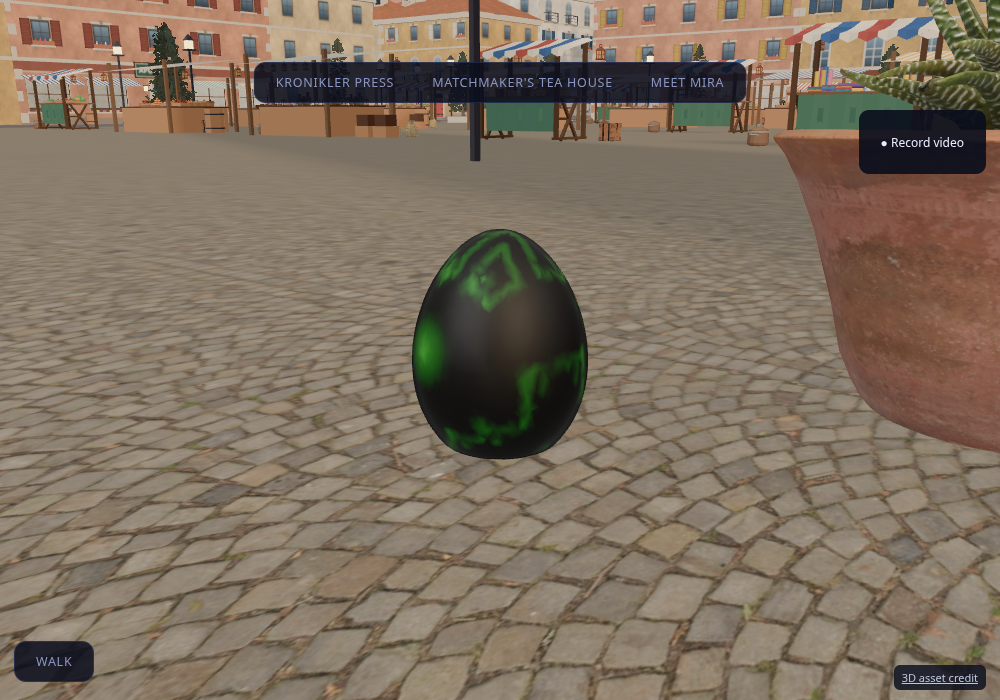

# SciFi EasterEgg placements

Thirty fixed eggs are placed across Sunstone Bazaar, Glass Quarter, Foundry Wharf, Garden Terraces and Halo Lagoon (six per district). `apps/console/public/assets/collectibles/easter-eggs.json` is the canonical placement manifest: stable IDs, world XYZ base positions in metres, headings, scale and hint text. Most eggs sit beside plazas, gardens, streets or landmark approaches; one sits at a bazaar tabletop edge. Final heights were checked against the shipped visual GLBs rather than assuming every surface is at y=0.2.

This is the prop-placement phase. `contestActive` is false; no collection, rewards, leaderboard or claim API is enabled. A later hunt can map a picked instance through `mesh.userData.eggIds` to the stable placement ID. Instance indices change as eggs are culled, so never persist an instance index. A prize contest will need server-validated claims and event state; the public placement manifest is not a secret answer list.

## Asset and preparation

The user uploaded `scifi_easteregg.zip` (5.77 MB), an embedded-license Sketchfab export of **SciFi EasterEgg** by **Cécile Amstad**, CC BY 4.0. The original ZIP and exact attribution text are retained in `tools/city3/assets/scifi_easteregg/`. `manifest.json` records source links, license, hashes and derivative information. The central upload catalog includes the new record.

Run `/workspace/tools/blender52 -b --python tools/city3/prepare_easter_egg.py` in this sandbox, or set `BLENDER_BIN` and use `tools/city3/blender_lock.sh` on another machine. The recipe reads only the known `scene.gltf` and `scene.bin` archive members. It joins chunks, welds coincident seams, recalculates normals, simplifies 333,344 triangles to 10,000, and normalizes the final base to zero and height to 0.5 m. Vertex colors are retained. The derivative is 281,620 bytes and needs no external textures. Per-placement scale gives heights of 0.375–0.5 m.

The browser gets one shared GLB, instanced by district in `EasterEggs.tsx`. Only eggs within 85 horizontal metres of the camera in loaded districts are drawn. Instance buffers are owned by the component; cached model geometry/materials survive StrictMode cleanup. The props are separate from the large city GLBs and collider roots, so city regeneration preserves them and they do not obstruct paths. A small in-world credit link opens the public author/license/modifications page.

## Verification

Asset tests inspect the real derivative, retain vertex colors, check its geometry/file budget and closed surface, ensure unique IDs and coverage, and raycast every placement against the shipped district assets with a nearby clear approach. A lifecycle test checks distance/district culling, stable IDs, StrictMode remounts and resource ownership. Browser close-ups verify the actual rendered asset and its context.

Production console build and all 464 tests passed. The repaired model was checked in Chromium with original vertex colors and no page errors.

