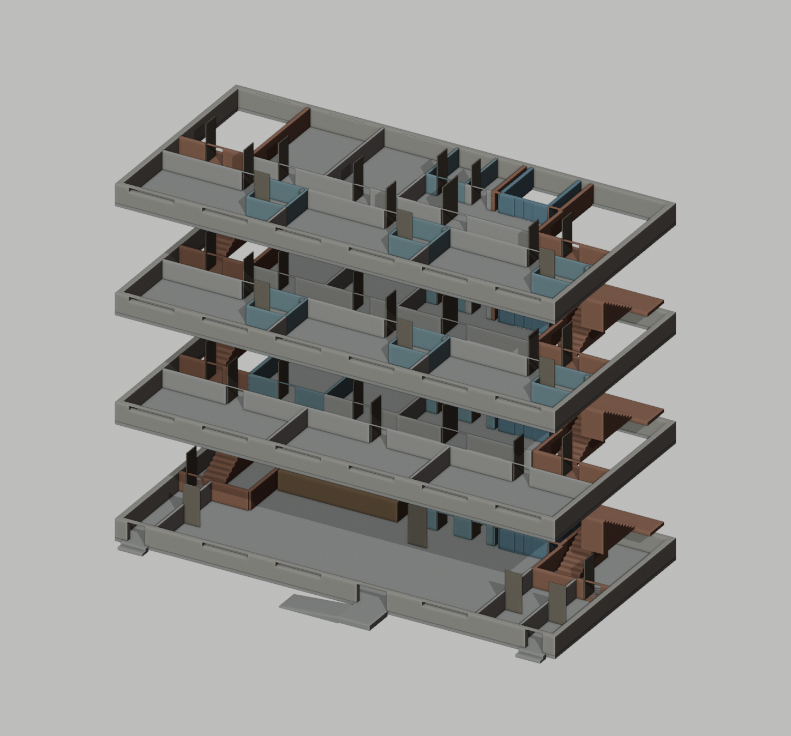
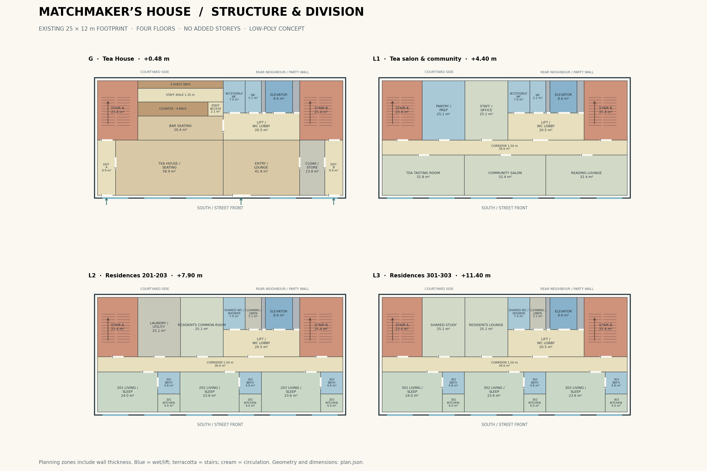

# Tea House: whole-building structure study

This is an isolated, editable low-poly proposal, not a change to the live city. It follows the owner's request to resolve the building shell, divisions, stairs, elevator and toilets before adding detailed props or materials.

## Survey: what exists

The Tea House occupies **shop-102**, the widest south-facing lot in block `(2,4)`. The shipped `interiors/index.json` identifies its 25 × 12 m footprint; a deterministic run of the current `tools/city3/plan.py` identifies **four floors** and an ochre façade under a pitched roof. The mesh agrees with the recipe's eaves and ridge heights.

| Datum | World height, m |
|---|---:|
| Street paving | 0.20 |
| Ground finished floor | 0.48 |
| L1 | 4.40 |
| L2 | 7.90 |
| L3 | 11.40 |
| Eaves / attic deck | 14.90 |
| Roof ridge | 18.5025 |
| Existing chimney top | 20.302 |

The city merges buildings by material, so there is no original single “Tea House” mesh node. `tea-house/existing-shell.glb` recovers a whole-triangle spatial subset of the building envelope, with its original material definitions and embedded maps preserved. Shared boundary faces may remain; this is a survey subset, not a reconstructed canonical source object. `survey.json` records the source SHA-256, bounds, selection method and per-mesh counts. The recovered envelope is 1,748 triangles. Its neutral Workbench render shows geometry, not the original textured appearance.

Only the ground floor has a streamed furnished interior. The visible upper floors are exterior façades; they do **not** already contain usable room divisions or full intermediate floor slabs. The roof attic is not counted as a fifth floor.

## Proposed programme

| Level | Rooms |
|---|---|
| G | Tea House seating, entry lounge, shortened bar, four shelf bays, staff access, cloak/store, two public toilets, elevator lobby and two stairs |
| L1 | Tea tasting room, community salon, reading lounge, pantry/preparation room and staff office, with the same circulation and toilet core |
| L2 | Studio homes 201–203, each with a living/sleeping room, kitchenette and private bath; shared laundry and residents' common room |
| L3 | Studio homes 301–303, repeating the wet layout below; shared study and residents' lounge |
| Attic | Roof/service zone and lift overrun; no added home or terrace |

The six homes are about 32–33 m² each before finished partition deductions. Every front room has street-facing window access. Rooms at the western rear can face the courtyard. West and east are party walls; the eastern rear half adjoins another building, so the proposal does not put doors or bedroom windows there.

## Circulation and the ground bar

Two U stairs sit at opposite rear ends. Each has 1.25 m flights, 280 mm goings and at least 1.25 m clear landings. The 3.92 m ground rise uses 24 risers (163 mm); subsequent 3.50 m rises use 22 risers (159 mm). Intermediate slabs have **real stair openings**. Upper corridors reserve 1.50 m; wall thickness is placed away from those clear circulation zones.

Both stairs discharge to the south street through separate 1.80 m ground passages and two new façade openings. The courtyard is enclosed by other buildings and is **not** assumed to provide a street exit. The original main entrance stays in its current bay. A simple 3.36 m parallel entrance ramp rises 0.28 m from paving to the entrance landing; its fit with the surrounding sidewalk must be checked when integrating the model.

The elevator zone is 2.70 × 3.20 m, with a nominal 1.60 × 2.10 m car target and a 1.10 m door. The shaft is continuous through actual slab openings, has a pit floor at −0.52 m and closes at +15.20 m under the existing roof slope. Car movement and supplier-specific equipment are later work.

The original layout has 11 shelf units and 367 bottles. The proposal reduces the rear bar to **four shelf bays**. Four shorter counter sections total 6.80 m and leave a **1.50 m access gate** at the right end; the shelf line remains about 8 m. This avoids trapping Remy behind a counter that spans the entire available opening. Toilets and elevator doors face a customer-accessible lobby, so visitors do not pass through the staff aisle.

Common toilets and service ducts stack vertically. The private residential bathrooms repeat on L2 and L3, with three small wet ducts at the corridor edge. Fixtures are not modelled in this structure pass.

## Files and reproducibility

All generated review artifacts live in [tea-house/](tea-house/):

- `floor-plans.png` — all four levels on one sheet.
- `section.png` and `tea-house-structure.pdf` — height stack, service reservations and larger individual plans (six PDF pages).
- `existing-shell.glb` — recovered source envelope; unchanged city source.
- `proposed-structure.glb` — assembled structure with simple materials, true door/window openings, slabs, divisions, stair flights and lift shaft.
- `tea-house-structure.blend` — editable project with a hidden source-envelope collection, separate floor collections, and a hidden exploded presentation collection.
- `structure-exploded.png`, `structure-assembled.png`, `existing-envelope.png` — inspected Workbench geometry views.
- `plan.json`, `survey.json`, `blockout-metrics.json`, `geometry-check.json` — machine-readable source, design and verification.

```sh
node tools/city3/tea_house/extract.mjs
python tools/city3/tea_house/plan.py
BLENDER_BIN=/path/to/blender tools/city3/blender_lock.sh -b --python tools/city3/tea_house/blockout.py
node tools/city3/tea_house/check.mjs
```

Node scripts use the installed console three.js dependency. Python drawing dependencies are matplotlib; the model builder uses Blender's bpy. Always use the Blender lock and do not render Blender alongside software Chromium. No external models, high-poly details, subdivision or texture baking are introduced.

The plan check verifies complete, non-overlapping floor coverage, doors on shared room boundaries, room connectivity to both stairs and elevator, and stair fit. The geometry check reads the actual exported GLB and raycasts floor surfaces, slab voids, every modelled stair tread, corridor clearance, real street openings, staff access, the lift pit and entrance ramp. The Workbench views are also inspected. These establish geometry and planning consistency, not structural load capacity, a fire certification or a working navigation system.

## Bringing the structure into the Verse

1. Review the structure and room allocation before adding furniture or materials.
2. Retain the existing architectural character and façade ornament; adapt the old merged shell only where real openings and slab holes are needed. The simplified proposal shell is a structural study, not a decision to erase the existing façade details.
3. Replace the old solid ground ceiling with the coordinated floor slabs. Update the generator and shipped layout together; do not only edit a `.blend` snapshot.
4. Add per-floor streaming and cutaway. Current clipping exposes only the ground interior; it will hide new upper floors unless changed.
5. Update real closed collision meshes, thresholds and the character routes. Current ground furniture boxes and single-height ground/navigation assumptions do not make the new stairs usable automatically.
6. Implement the restroom door, elevator doors/cabin controls and multilevel travel, then place furniture without obstructing the circulation reservations. Re-check the entrance ramp and both exit paths against surrounding city geometry.

No runtime asset URL or current Tea House layout is changed by this study. The original bar and bottles remain in the live world until the structural proposal is integrated and shipped through a PR.




