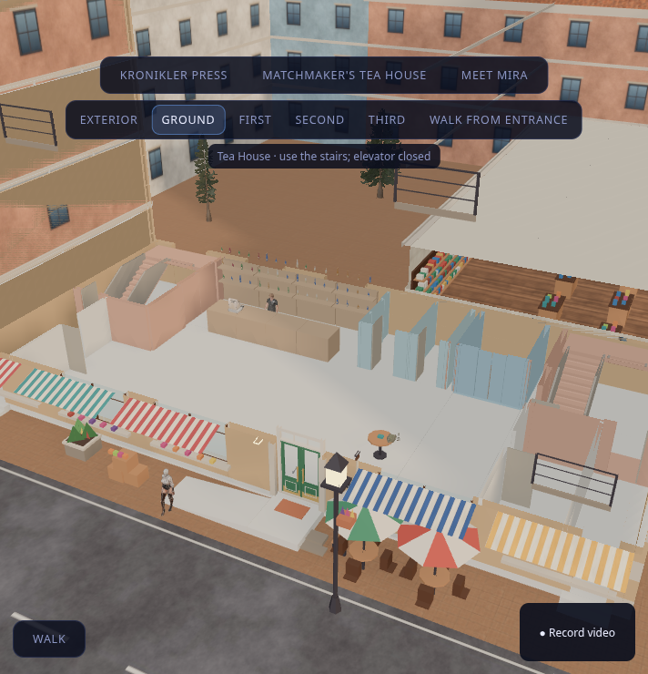
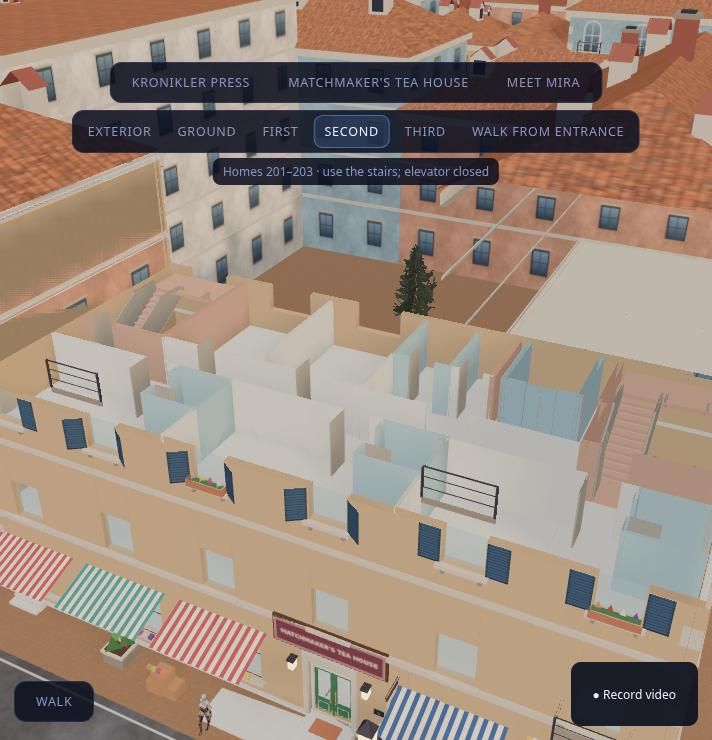

# Tea House: City 3 integration

The four-floor structure is installed in the **local console preview**. It is not deployed or merged to main by this work. The structural pass keeps the existing pitched roof, dormers, chimney, fascia/sign, corner trim, shutters and entrance pilot. Warm ochre shell walls replace the old solid façade planes; ground and alternating upper window openings align with the original window kit. The two new street exits replace the end ground window bays. Upper rooms remain sparsely furnished for the structure review.

## Assets and generator

`tools/city3/tea_house/prepare.mjs` applies a scoped integration to the frozen pre-integration files in commit `22ba63a`. Re-running starts from that revision, never from its own generated output, so payloads do not grow every iteration. It preserves the original GLB binary prefix and every unrelated mesh, material, image, instance transform and accessor. Changed primitives get new index accessors; the new structure is appended as a named `TeaHouseStructure` root at `[-37.5,0,-72.5]`.

The source city's legacy Tea House walls/floor and solid upper collision block are removed by whole-triangle spatial selection. The old entrance stoop is replaced by the new landing and ramp. The two audited west café sets are removed, and the 32-triangle planter (including foliage/flowers) moves intact to `(u=6.25,d=-0.8)`. A plinth closes the paving-to-floor-slab gap. Ground triangles are subdivided around the elevator pit rather than deleting the island floor. Existing neighboring buildings and all other districts are retained.

`public/assets/tea-building.json` records source revision/hash, changed face counts, the shipping world hash, floor datums and the bottle count. The old shared library is unchanged. The ground layout now has **48 bottles** on four sparse shelf displays, the register and a radio table. Conflicting old tables, booths, lounge pieces and 11-unit shelf run are removed from this structural layout. The radio's definition, stand pose, table collision and stale Tea House seat anchors are updated together.

```sh
python tools/city3/tea_house/plan.py
BLENDER_BIN=/path/to/blender tools/city3/blender_lock.sh -b --python tools/city3/tea_house/blockout.py
node tools/city3/tea_house/check.mjs
node tools/city3/tea_house/routes.mjs
node tools/city3/tea_house/prepare.mjs
```

The design route audit deliberately retrieves its pinned pre-integration city from Git when the shipping file has changed, so its before/after comparison stays reproducible. A checkout needs the `22ba63a` source object (normal full clone or fetch sufficient history). This workshop integration is scoped to that source revision; when accepting later city asset changes, update/rebase the source deliberately rather than overwriting them with the old base.

## Viewing and walking

Click **Matchmaker's Tea House**, then **Exterior / Ground / First / Second / Third**. `?teaFloor=0`, `1`, `2`, `3`, or `exterior` links directly to a view. Floor selection changes the orbit target and clipping height. While walking on the stairs, the cut follows the actual feet height plus 2.10 m; selecting a floor in spectator mode does not inherit stale walker height or move the walking camera. The camera collision sweep filters clipped surfaces and continues to the next visible face, including multiple hits within one BVH mesh.

The resident collision loader now preserves two categories: structural walking surfaces, and `noGround` blockers. Doors, guards, glass and walls still block the body but cannot become floors. The pit base is a walking surface; the pit walls are blockers. Thin closed window panes stop characters walking out through upper windows. The elevator doors remain closed and the elevator is not used as a route between floors.

Remy stands 6 cm behind the counter face, leaving a body-width passage behind him. His greeting zone matches the shorter counter and ignores visitors on upper floors. Both staff gates and the passage behind him are tested with his actual body collider present.

## Verification

`tests/tea-building-assets.test.ts` loads the **actual shipped collision GLB**, bakes it through the production collision code, and adds the shipped radio-table sidecar and Remy's body. It checks:

- floor datums, the lift pit, and the separation of blockers from ground;
- walking both stairs up all three storeys and down again with `walker.step`;
- complete upper corridors, both street discharges and the graded entrance (entrance pilot open);
- movement behind Remy through both staff gates;
- blocking upper windows and the closed lift;
- every occupied/circulation zone reaching both stairs on a 10 cm physical grid, including the radio table and NPC, with 2.10 m headroom.

Validation on the integrated assets: **473 tests across 50 files passed after integrating main `22ba63a`**, including the eight Tea House asset tests; the production TypeScript/Vite build passed (existing bundle-size warning only). A final targeted run passed 25 tests across four files after the floor camera changes. An alternate-output generator run reproduced all seven shipping files byte for byte.

The standalone design audit still checks 102 routes, 47 human openings, six stair trajectories and guard/shaft blocking. The existing main-door panel split, radio interaction and bartender tests remain active. The camera test includes a clipped front surface with a visible surface behind it in the **same** BVH mesh.

Remaining work is door interaction for the newly added interior doors, a working elevator with interlocks, and room furnishings. Those are not represented as implemented. Publish through a PR only when requested; a local preview is not a production deployment.

The final Chromium run captured all five floor/exterior views with **zero JavaScript page errors**. “Walk from entrance” started the capsule walker on street paving; browser ground queries returned 0.48, 4.40, 7.90 and 11.40 m. Full stair travel was verified by the production walker asset tests, rather than inferred from those four queries. Results and screenshot hashes are saved in `tea-house/runtime-validation.json`.

## Console captures

Actual City 3 browser renders from the Tea House integration before main advanced to `22ba63a`. The subsequent merge preserves the new Bazaar cleanup and Easter eggs; its combined assets are rechecked by the production asset tests and build.





Other views: [first floor](tea-house/runtime-first.png), [third floor](tea-house/runtime-third.png), [exterior](tea-house/runtime-exterior.png).

## Floor textures (2026-11-12)
`prepare.mjs` is pinned to commit `22ba63a` (before the KTX2/meshopt world); re-running it would undo later main changes. Floors are therefore patched onto the shipped GLB by `tools/city3/bridge_tea_floors.py` (append-only, bridge_* family): the up-facing slab triangles of each level are clipped to the `plan.json` room rectangles, so stair/lift openings stay exactly where they were, and re-emitted per room with a CC0 colour+normal texture (`make_floor_textures.py` builds the JPEGs). Wet rooms (except the pantry), lift and shaft rooms keep the old slab faces. Collision GLB untouched. Floor area is unchanged (295.4 m2 ground, 242.4 m2 per upper level). Run it only on an unpatched GLB (it refuses if `TeaFloor_*` materials exist). New textures are JPEG, not KTX2 (no `toktx` on the box): +0.84 MB.
