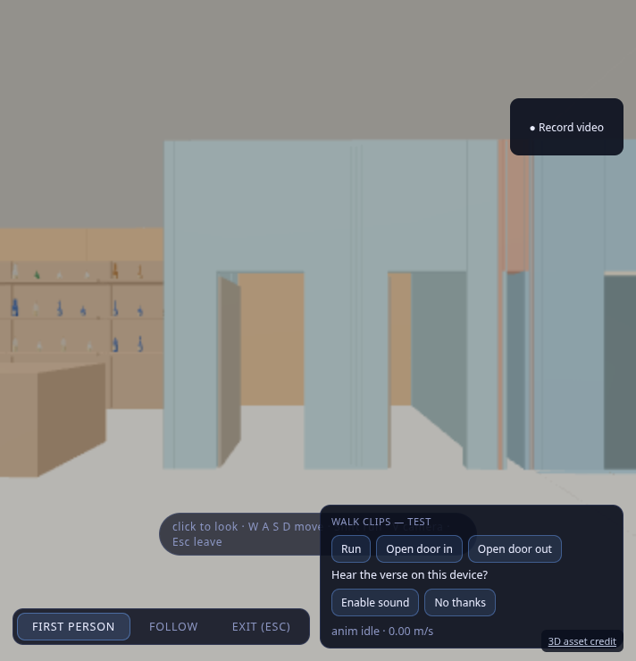
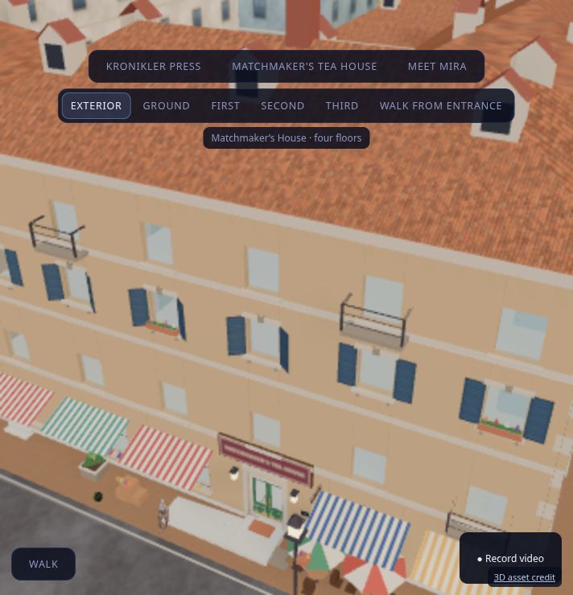

# Tea House elevator implementation

The elevator is a local, four-stop kinematic cabin. PR #67 supplies the building structure; this change supplies the moving cabin, landing doors, controller, moving support and controls. It does not add shared multiplayer elevator state.

## Using it

Walk Summer through the Tea House entrance to the core lobby, just right of the bar. Near the elevator, press **E** or tap **Elevator controls**. Call up/down at the landing. When both door pairs open fully, dismiss controls and walk inside. Open controls again, select G/1/2/3, then dismiss them to keep looking or walking. The cabin carries the character continuously. Walk out after arrival. Open/Close/Hold controls are available in the cabin. Escape dismisses an open panel before exiting walk mode. Sound is optional and follows the existing consent and volume controls.

## Mechanics and ownership

`TeaElevatorController` owns the request queue, directional hall calls, door interlocks, obstruction checks, capacity limit, analytic acceleration/cruise/deceleration and arrival leveling. It ticks once before walkers, at bounded substeps; tab suspension does not fast-forward the cabin. Pending requests are deduplicated; calls received in motion are queued for a later dispatch. Waiting calls gain priority after 30 seconds. Motion uses 1.2 m/s maximum speed and 0.8 m/s² acceleration. Doors take 1.5 seconds; normal clear dwell is four seconds.

`createTeaElevatorAssembly` builds the cabin and all landing leaves from shared visual/collision dimensions. Only its floor and landing sills provide ground. Translation offsets transform capsule and ground queries into collider coordinates without rebuilding BVHs every frame. The walker’s support hooks retain cabin-relative position while carrying feet height; regular walking still controls entry and exit. All local walkers using `makeWalkWorld` receive the same support adapter.

The asset preparation script splits only the 24 isolated placeholder door triangles per floor from the old merged shaft meshes. The shaft, walls, pit and roof remain intact. Closed, separately tagged placeholder leaves stay in the GLBs as fallback protection. The resident collision bake excludes them only after the dynamic elevator is installed. Dynamic landing gates remain blocking until the car is aligned and the doors are fully open. A threshold obstruction reopens doors; excess cabin occupancy prevents departure. No landing opens onto an absent car.

StrictMode remount preserves riders and the controller. Final cleanup restores static landing protection before disposing dynamic geometry, unregisters camera obstacles, and releases carried actors at a landing. Exiting walk mode releases that actor’s registration and any held-open control. A fault at an aligned landing permits exit; a mid-trip fault keeps doors shut and offers an explicit, collision-checked return-to-landing action. Recovery moves only supported passengers, with separated landing positions; remote actors and people waiting on other floors remain where they are. Arrival uses the existing consented sound bus for a chime; a motor sound and decorative detailing are deferred.

## Disappearing-building fix

The previous cutaway logic clipped everything above the walking character plus 2.1 m. That exposed sky and disconnected façade details while moving through the building. Walking now always uses inactive clipping planes. Tea House defaults to Exterior, and floor cutaways require explicit Tea House inspection. The floor caption labels that mode. Hidden placeholder leaves also no longer block camera sweeps. Cabin ceiling/light materials retain their enclosure when inspecting a floor.

## Verification

The elevator asset tests load the shipped collision GLB, remove the tagged fallback leaves through the production filter, install the actual dynamic assembly and drive the production walker. They cover boarding/exiting all floors, full ascent/descent, bounded speed, absent-car landing protection, obstruction reopening, queued and directional calls, hold-open, over-capacity protection, frame hitches and fault recovery. Recovery tests include remote and waiting actors. React tests check StrictMode ownership, final cleanup, hall/cabin controls and Escape dismissal. Existing stairs, room routes, entrance, radio and bartender tests remain active.

The browser harness drives actual movement intents through CityWalker, uses the visible hall/cabin buttons, and records the production scene. It does not teleport between floors. Browser evidence, final test totals and asset hashes are recorded separately after successful completion. The captured ride is simulation-paced in a software renderer; it is not a GPU performance measurement.

Final validation: **486 tests across 52 files**, TypeScript and production build passed. All seven generated outputs reproduce byte for byte. The browser completed street → Tea House → cabin → third floor → cabin → ground → street with zero page errors and no teleport commands. The final walking shader planes exactly matched `inactivePlanes()`. See `tea-house/elevator-validation.json` and [recorded cabin ride](tea-house/elevator-ride.mp4). The cabin video is sampled at 2 fps; the full journey is checked in the trace, and the video covers ascent and third-floor exit.

Re-run the browser journey with Playwright and Chromium installed: `NODE_PATH=/path/to/node_modules node tools/city3/tea_house/test_elevator.cjs`. Set `TEA_PREVIEW_URL` and `TEA_ELEVATOR_CAPTURE_DIR` for a different server/output directory.
