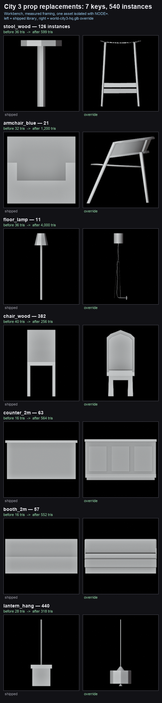
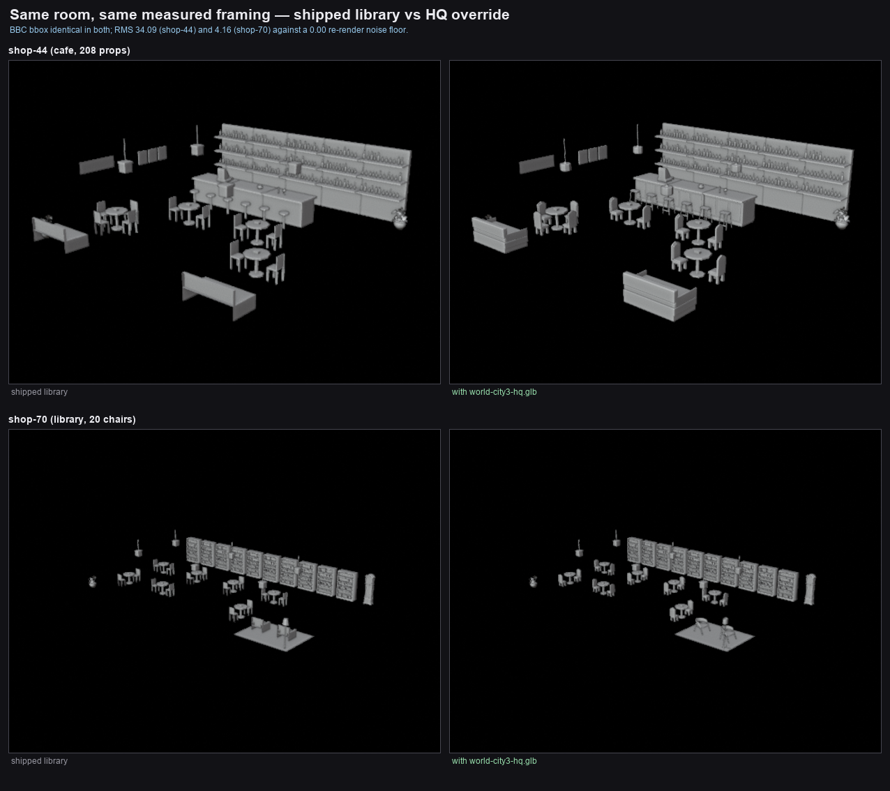

# 28 — World GLB gates, local, without the cloud wrapper

Written 2026-11-25 on macOS arm64 (Blender 5.4.0 Alpha, system python 3.9.6 + numpy 1.26.4 +
PIL 10.4). This recreates the gates and techniques built in the 2026-11-24 cloud session
(`blender-wb`, `preview_multi.py`, `sheet.py`, `unpack_sheet.py`, `uv_stats.py`,
`placement_audit.py`, `dims_gate.py`, clip audit) on a box with no EGL shim, and records what
actually transferred and what did not.

One command, five gates, no display:

```
python3 tools/city3/world_gate.py            # + --uv, --render, --fast
```

## The gates

| Gate | File | What it proves | Measured here | Planted control |
|---|---|---|---|---|
| dims | `dims_gate.py` | Kit spec dims vs shipped GLB, 3% tol, through node matrices | 0.14 s, 11/11 within 0.4% | node scale 1.25, rotY 90, parent-empty scale, axis permute |
| dims-lib | `dims_gate.py --spec=out/world-library-dims.json` | All **75** `LIB_` dims against a pin, so the 64 assets outside the kit can't drift | 0.13 s, 75/75 | pinned spec + planted node scale |
| placement | `placement_audit.py` | Layout JSON props vs library bounds vs room rect | 0.68 s, 77 rooms, pinned baseline | through-wall, duplicate, unknown key, legitimate stack |
| clips | `clip_audit.py` | Animation structure + 594 pinned clip names/durations | 0.39 s, 11 bodies | duplicate name, zero-length clip, orphan channel |
| images | `unpack_sheet.py` | Embedded images, KTX2 honesty, duplicate payload | 1.65 s, 429 images | KTX2 reported undecodable, never guessed |
| uv | `uv_stats.py` (Blender) | Per-triangle UV-area / world-area, unmapped faces, pinned density | 1.26 s, 115,284 tris | 4x UV stretch, collapsed UV, uniform 1.5x rescale |
| degenerate | `bridge_drop_degenerate.py --check` | No live primitive (indexed or not) carries a triangle of area <= 1e-9 m^2 | 2.2 s, 264,601 tris, 0 degenerate | pre-2026-11-26 world: 70,873 of 335,474 (exit 1) |
| eaves | `bridge_eaves.py --check` | Single-sheet roof materials (`roof_tile_v4`) are `doubleSided`, so eaves show from the street | 0.1 s | pre-2026-11-26 world: roof invisible from below (exit 1) |

Degenerate triangles (2026-11-26): demolition passes collapse "killed" triangles in place, so 21% of the
world's accessor triangles drew nothing (60,284 in `palette`; 37 primitives, e.g. every `BzFacade_shop_*`,
were 100% dead). Blender's importer silently drops zero-area faces, so a Blender census shows ~266 and hides
this; count in the raw GLB. Fix: `bridge_drop_degenerate.py IN OUT` then `bridge_compact.py OUT OUT2 --drop-dead`
(60.0 -> 58.9 MB). It writes a new index accessor per primitive and keeps the old component type
(`tea-furniture.test.ts` pins uint32 on Tea props). Workbench before/after at 8 cameras: 0-4 isolated
pixels per 518k (depth ties), tiles `verify_tiles` PASS x2.

`world_gate.py --uv` runs all five in **5.5 s** and writes `out/world-gate.json`.
Shared reader: `tools/city3/glb.py` (pure python + numpy: header, node world matrices,
subtree bounds from accessor min/max, instancing, embedded images, animation channels).

## Parity with the cloud process

| Cloud tool / technique | Local result | Verdict |
|---|---|---|
| `blender-wb` EGL/Mesa wrapper | **Not needed.** `blender -b --factory-startup` renders Workbench headless on macOS | Optimization gained, differently: no shim to maintain |
| `preview_multi.py` + `sheet.py` | Already on main (PR #323); ran unchanged | Same tool |
| Browser three.js viewer (Playwright + SwiftShader + KTX2) | **Not reproduced here** | Workbench covers silhouette/framing; KTX2 still needs three |
| `unpack_sheet.py` | 429 images in 2.8 s: 323 decoded, 106 KTX2, 0 failed, **4.5 MB duplicate payload in 210 repeats** | Gained, plus a size finding |
| `uv_stats.py` | 27/115,284 unmapped (0.02%), all in `cabinet_modern` (18), `sofa_settee` (8), `bar_chair` (1) | Gained, with a corrected verdict rule (below) |
| `placement_audit.py` | 77 rooms; 110 findings pinned, 0 new | Gained; the baseline is new |
| `dims_gate.py` | 11/11 pass; 10/11 **fail** without the axis permute | Gained; permute is load-bearing |
| Clip audit | 594 clips, 0 findings, 0.59 s | Gained; the count is **54 per body, not 53** |

## Techniques that transferred, with local numbers

**Planted-defect controls.** 6 in dims, 5 in placement, 3 in clips, 3 in UV. Each gate has to
catch a deliberate break before its clean verdict counts. The dims gate additionally requires a
*transform-blind* variant to MISS the scaled node — that miss is the proof the scene-graph
composition is doing the work.

**Noise floor first.** Two identical `preview_multi` runs of the same prop differ by **RMS 0.00**
on every view. So any non-zero delta is signal, not render noise.

**Rotation is invisible to silhouette stats; RMS catches it.**

| Variant | front fill / coverage | RMS vs base |
|---|---|---|
| base re-render | 75.4% / 31.4% | 0.00 |
| "rotated" via `rotation_euler` | 75.4% / 31.4% | **0.00** |
| rotated via `rotation_quaternion` | 87.9% / 21.2% | **29.08** (left 28.46) |

The quaternion variant's numbers are the base's numbers **permuted between views** — every
individual stat stays in the normal range. Only the baseline comparison sees it.

**Quaternion awareness, measured.** A glTF import comes in with `rotation_mode == 'QUATERNION'`.
Setting `rotation_euler = (0,0,pi/2)` stores 1.571 in the euler field and leaves
`matrix_world[0]` at `[1,0,0,0]`; switching the mode to XYZ discards it (euler resets to 0).
Setting `rotation_quaternion` moves the matrix to `[-0,-1,0,0]`. Also: `matrix_world` is stale
until `view_layer.update()`, which is exactly how a "rotated" variant can render identically.

**Strip animations on export.** `cast-cipher.glb`, 54 clips:

| Export | Time | Size |
|---|---|---|
| `export_animations=False` | **0.1 s** | 1.55 MB |
| `export_animations=True` | **59.0 s** | 10.03 MB |

The cloud's 222 s was that box; the ratio (590x locally) is the portable part.

**Room composition from data.** 77 room layouts × 75 `LIB_` bounds audited with zero renders.
The layout prop is `[key, x, y, z, rotY, scale]` in three space; the box is the GLB subtree
bounds times scale, rotated by SAT, spanning `y .. y + height*scale`.


## Traps found building the local gates

1. **Axis convention in the dims gate.** The kit spec records Blender Z-up
   `[x, depth, height]`; the GLB is glTF Y-up `[x, height, depth]`. Without the permute, 10 of
   11 assets read 17–2778% wrong while being perfect. A gate that reports 10 failures on a clean
   kit is worse than no gate — it trains you to ignore it.
2. **Containment is not collision.** Books sit inside a bookcase's bounds, an armchair inside a
   rug's, a bottle inside a shelving unit's. Comparing raw AABBs flagged 4,668 "interpenetrations"
   across 77 rooms. Skipping different support levels and fully-contained footprints drops it to
   110, and the 110 are inspectable.
3. **AABB cannot model hollow furniture.** Even with containment, `shelf_goods_a x
   wooden_bookshelf_worn` (0.39 m) and `booth_2m x potted_plant_02` (0.25 m) are ambiguous: the
   boxes overlap, the meshes may not. That is why the findings are **pinned** in
   `out/placement-baseline.json` and the gate fails only on new ones — the same pattern
   `verify_rotation` uses.
4. **Per-object UV deviation is not a verdict.** `LIB_plant_pot_1` is a 176k→24k decimated plant
   with alpha-card leaves; 59% of its triangles deviate >16x from its own median density *by
   design*. 15.8% of the kit's triangles "failed" a 4x rule. The honest failures are unmapped
   faces (UV area 0 on a live triangle) and missing UV layers: 27 triangles, 0.02%. A uniform
   rescale of an object's UVs is invisible to *deviation* (it stays 1.0) but not to a **pinned
   density**: measured, 2x UV scale moves density 0.25 → 1.0 with 0 outliers, so
   `uv_stats.py --pin/--baseline` is what catches it.
5. **`EXT_meshopt_compression` is required** by `world-city3.glb` and
   `world-city3-library.glb`, so their POSITION buffers cannot be decoded outside a meshopt
   decoder. Accessor min/max is exact and is the only Blender-free path; Blender's importer does
   decode meshopt (8 MB library: 1.5 s, 96 meshes, 93 UV layers), so the UV gate stays in Blender.
6. **SAT sign convention.** A rotated-axis radius computed with the wrong sign returns 0
   penetration for real overlaps — a gate that passes everything. The control that catches it is
   the planted duplicate, so keep it.
7. **`matrix_world` is stale without `view_layer.update()`**, and `rotation_euler` on a
   QUATERNION-mode object changes the field, not the transform. Both make a "rotated" export
   byte-identical, which is exactly the RMS 0.00 the cloud session saw.

## Second pass (same day): what was fixed, and what refused to be fixed

**Applied and verified**

| Fix | Method | Evidence |
|---|---|---|
| 4.47 MB duplicate image payload in `world-city3.glb` | `dedupe_images.py`: repoint identical images at one bufferView, delete only image-only byte ranges, shift every later offset | 60.85 → 56.58 MB; all 19,869 retained views byte-identical; Blender census before/after equal on 4,058 meshes / 3,270,343 verts / 2,650,274 polys / 295 materials / bbox |
| Counter lip 2.1 m on a 2.0 m pitch | `rooms.py`: body ±0.98, lip ±0.999 | 4 coplanar face pairs / 0.456 m² at every joint measured before the change; simulation of the new dims removes all 47 counter pairs |
| `paper_stack` 0.5 m apart (asset 0.64 m wide) | `press.py`: stacks 0.9 / 0.7 m apart | simulation: 1 pair → 0 |
| cafe plant inside window booth 0 | `rooms.py`: near-corner plant removed | simulation: 16 pairs → 0 |

Simulated together (`placement_audit` with the new counter dims and the respaced props): **110 → 47 findings**, exactly the three classes fixed.

**Refused, with the reason**

Re-exporting `world-city3-library.glb` to patch the counter in place is **not** a surgical
operation on this box. Even with every `LIB_` subtree selected, a Blender 5.4 alpha
import → export round trip yields 100 nodes / 94 meshes / 75 materials / 50 images from the
shipped 103 / 96 / 79 / 56, and re-encodes 2 images. A geometry fix that silently drops 3
nodes, 4 materials and 6 images — with no browser on this box to look at the textures — is a
worse trade than a 0.456 m² z-fight. So the geometry fix lives in `rooms.py` and takes effect at
the next real build; the shipped file is untouched. `use_selection=True` also silently omits the
six no-mesh `LIB_` parents' children unless their subtrees are selected.

## Replacing low-poly props: an override library, not a rebuild

**The premise had to be checked first.** Scanning `world-city3.glb` for "low-poly boxes with
split geometry" found 872 mesh nodes with a 0-triangle count — but they are **unindexed**, not
empty: `L1_panel_field` is 6 vertices / 2 triangles with no index buffer. Those are the window
and door panels emitted as separate 2-triangle nodes (the real "geometry splits"). Deleting them
would erase every window and door in the city, so they stay; consolidating them is an export-time
join, not a deletion.

The replaceable unit is the **library prop**, and the runtime makes that free: `indexLibrary`
keeps the *first* node per key (`!out.has(key)`), so a library indexed ahead of the base one
shadows a key — no layout JSON edits, no re-export of the 8 MB library.

```
blender -b --factory-startup --python tools/city3/hq_library.py -- --dry   # budget report
blender -b --factory-startup --python tools/city3/hq_library.py            # -> out/world-city3-hq.glb
cp tools/city3/out/world-city3-hq.glb apps/console/public/assets/
```

`out/hq-map.json` is the mapping: `key -> {src, budget, yaw}`. Two rules learned building it:

- **Budget from the instance count, not from the scan.** `chair_wood` has 382 instances; a 16k
  scan would add 6.4M triangles to a 2.65M-triangle world. `stool_wood` (126) got 600 tris,
  `armchair_blue` (21) 1,200, `floor_lamp` (11) 4,000.
- **Cap textures.** The first build was 11 MB for three props (1k scans); at 256 px the same
  three are 596 KB. A room composed with the override is +42 KB over the base room.

Dims are fitted per axis to `out/world-library-dims.json` and **asserted within 0.5%**, because
collision boxes and seat anchors depend on them. Verified batches:

| key | instances | before | after | render |
|---|---|---|---|---|
| `stool_wood` | 126 | 36 tris (T-shaped stick) | 599 tris (legs + footrests) | clearly better |
| `armchair_blue` | 21 | 32 tris (notched cube) | 1,200 tris (back, arms, legs) | clearly better |
| `floor_lamp` | 11 | 36 tris | 4,000 tris | **800 tris shredded the pole** — raised until it read as a lamp |
| `chair_wood` | 382 | 40 tris (slab back) | 256 tris, yaw −90 | proper chair in the room render |
| `counter_2m` | 63 | 16 tris | 564 tris: plinth, carcass, panelled front, bevelled top, kick rail | clearly better; **1.998 m wide** |
| `booth_2m` | 57 | 16 tris | 552 tris: plinth, seat + back cushions, two arms | clearly better |
| `lantern_hang` | 440 | 28 tris | 318 tris: cord, cap, 8-sided drum, finial | clearly better |

`world-city3-hq.glb` is 7 props / 649 KB / 7,489 tris. Room checks: `shop-44` bbox identical to the
base (11.179 × 11.34 × 3.92 m), `shop-70` identical, noise floor 0.00. `placement_audit --lib
hq,base` drops from **110 to 63 findings**: the 47 counter pairs disappear because the override is
1.998 m on a 2.0 m pitch (the 63 that remain are the booth/plant, shelf/bookcase and barrel
classes, which are layout fixes not yet built).






The three procedural ones come from `hq_props.py` (authored at the pinned dims, front −Y), because
every scanned candidate for them is a whole scene. Detail, not tessellation: a counter reads
better with a plinth and panel run than with 5,000 triangles of flat box.

**Trap: dims are translation-invariant, so the pin cannot see an origin.** Two of the three are
anchored differently from a free-standing chair — the lantern hangs from its origin (height range
−1.25..0) and the booth is wall-mounted (z −1.05..0). Forcing bottom-centre made the lantern hang
upward (the room grew from 3.92 m to 5.17 m tall) and centring the booth left it 0.5 m off the
wall. `fit()` now takes `anchor=bottom|top|back|front`, and the check that catches it is the
**composed-room bbox against the base**, which is exact (0 objects differing >5 cm) rather than
approximate. A future pin should record the min corner too, not just the size.


**Rejected after rendering, not before:**

- `shelf_goods_a/b -> wooden_bookshelf_worn`: the base prop has **goods on the shelves**; the
  bookcase is empty. That is a downgrade, so it stayed out of the map.
- Every raw scan tried for the remaining keys is a **whole scene**, not a prop:
  `int-pendant-bell` is 9 × 9 × 33 m, `int-kitchen-island` 11.6 × 8.9 m, `int-dining-scandi`
  4.7 × 3.7 × 8.1 m. Scaling one of those into a 0.4 m lantern or a 2.1 m counter is nonsense, so
  those three were **authored procedurally** in `hq_props.py` instead of rescaled.

**Trap re-confirmed: the yaw must be baked into the mesh.** The chair came out side-on, and the
first fix (`rotation_euler = 90°`) was a no-op because a glTF import is in QUATERNION mode — the
same trap the render baseline exposed earlier. `fit()` now uses `mesh.transform(Matrix.Rotation…)`.
Even then +90° showed the chair's *back*; −90° is correct. Both were caught on a 260 px isolated
render, not guessed.


Room check: `shop-44` composed with and without the override — identical bbox (11.179 × 11.34 ×
3.92 m), RMS 2.28 (noise floor 0.00), i.e. the change is local to the swapped props. Console
typechecks (`bunx tsc -b`, exit 0). The old props still ship inside the base library as dead
weight; removing them needs the rebuild that this box cannot do losslessly.

Check a replacement before shipping it — `NODE=` isolates one asset, which is how the broken
800-tri lamp was caught rather than guessed:
```
NODE=LIB_floor_lamp ENGINE=BLENDER_WORKBENCH blender -b --factory-startup \
    --python tools/city3/preview_multi.py -- apps/console/public/assets/world-city3-hq.glb /tmp/pv front
```


## Closing the remaining findings: a layout bridge, not a rebuild

The 63 findings left after the HQ overrides were pure layout classes (a lone bookcase
buried in the workshop's shelf run, cafe plants inside the back-wall shelving, ink barrels
standing in desks, paper stacks 0.5 m apart). Their source fixes live in `rooms.py` /
`press.py`, but those only reach the shipped JSONs on a generator run this box cannot do
(no Poly Haven sources). `bridge_layout_props.py` applies the same decisions to the
committed layouts:

- a plant never pushes a counter: the collision victim is the prop with the **smaller
  footprint**, and if both are fixtures the layout is left alone;
- the victim moves to the nearest free spot from a ring search (0.1 m steps, 8 directions,
  2 m limit) instead of being guessed, and is dropped only if nothing fits;
- 53 moves across 30 rooms, **0 drops**; the diff is 30 files × one line; idempotent.

`placement_audit` also learned the rule the tea room exposed: **a rug is a floor covering,
not an obstacle** (furniture stands on it), so pairs where either prop is ≤ 6 cm tall are
not collisions.

Result with the shipping library set (`hq` indexed first, exactly as the runtime does):

| state | findings |
|---|---|
| before any fix | 110 (47 counters, 16 booth/plant, 16 shelf/bookcase, 13 plant/shelving, …) |
| + HQ override (counter 1.998 m) | 63 |
| + layout bridge, + rug rule | **0** |

`check_anchors.py` still reports 77 rooms / 1,064 anchors / **0 issues** after the moves, and
the placement baseline is now empty (0 pinned), so `world_gate.py --strict` is green.

Still open, and not placement: 18 unmapped triangles in `LIB_cabinet_modern` (decimation
artifacts, under the 1% threshold), and no browser/KTX2 gate on this box — texture review
still needs the three.js harness.


## Run

```
python3 tools/city3/world_gate.py --uv            # 6 gates, 4.3 s
python3 tools/city3/world_gate.py --strict        # pinned placement findings fail too
python3 tools/city3/dims_gate.py --selftest
python3 tools/city3/placement_audit.py --selftest
python3 tools/city3/placement_audit.py --update-baseline      # after triage
python3 tools/city3/dims_gate.py <lib.glb> --pin=out/world-library-dims.json
python3 tools/city3/clip_audit.py --pin=out/clips-baseline.json
blender -b --factory-startup --python tools/city3/uv_stats.py -- <glb> \
        --pin=out/uv-baseline.json          # then --baseline= on later runs
python3 tools/city3/dedupe_images.py <glb> [--write]
blender -b --factory-startup --python tools/city3/room_preview.py -- --rooms shop-44
NODE=LIB_stool_wood ENGINE=BLENDER_WORKBENCH blender -b --factory-startup \
        --python tools/city3/preview_multi.py -- <library.glb> /tmp/pv front
```

`room_preview.py` composes a room from its layout JSON + library (the runtime's own rule), which
is what makes a room renderable at all — the shipped world has no per-room GLB. It converts
three space to Blender as `(x, -z, y)` and clones whole subtrees, because six `LIB_` nodes carry
no mesh of their own.

Note on the render gate: it points at `interior-kit.glb`, where every `LIB_` asset sits at the
origin, so the sheet shows all eleven stacked. Use `NODE=` to isolate one. `out/world-images.png`,
`out/gate_render/` and `out/world-gate.json` are gitignored; `out/placement-baseline.json`,
`out/world-library-dims.json`, `out/clips-baseline.json` and `out/uv-baseline.json` are committed
on purpose — those are the pins.

## What NOT to trust

- **A single silhouette stat.** A quaternion rotation permutes the same fill/coverage numbers
  between views; only RMS against a baseline separates it from a clean render.
- **Per-object UV deviation as pass/fail.** Authored prop UVs legitimately span >16x.
- **AABB overlap as a collision oracle** for hollow furniture (bookcases, booths, rugs).
- **A remembered clip count.** This box has 54 clips per cast body, not the 53 in the cloud note;
  a gate keyed to a memorised number would have failed a clean rig.
- **`rotation_euler` on an imported glTF.** It writes a field nobody reads.

