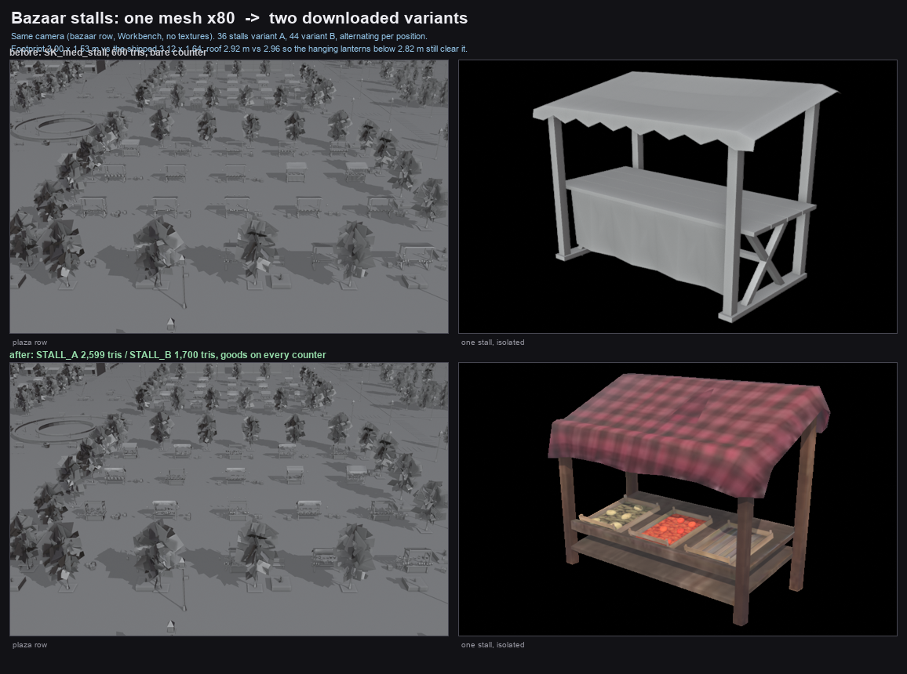
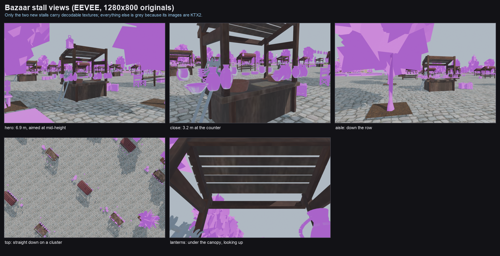
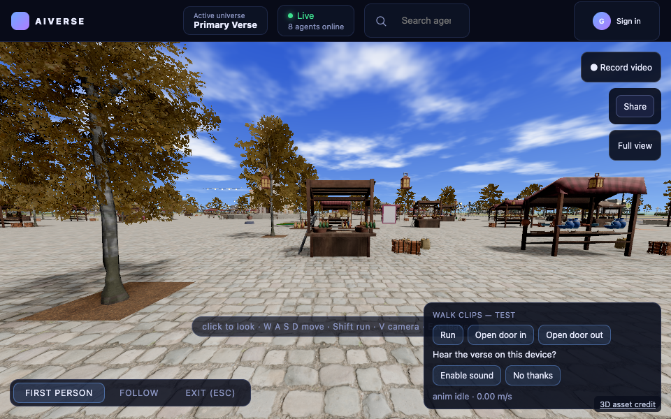

# 29 — The bazaar stalls

The plaza is the largest open space in City 3 and the only one whose furniture you
walk *through* rather than past. It had one stall: `LIB_sk_med_stall`, a 600-triangle
mesh instanced 80 times. Every counter was empty, every stall identical, and the nodes
carried a non-uniform scale of (1.4, 1.2, 1.4) that stretched the source mesh 15%
above its authored height.

This page records what the audit found, what was replaced, and the two measurement
traps that between them nearly produced a wrong diagnosis and a shipped regression.



## What the audit measures

`stall_audit.py` (gate 7 in `world_gate.py`) reports:

| finding | meaning |
|---|---|
| `thrifty_stalls` | every stall is the same mesh: no variety in the largest open space |
| `bench_overlap` | a bench or crate standing inside the stall counter |
| `lantern_through_roof` | a hanging lantern whose body rises above the stall roof |

Before: `thrifty_stalls 1`, `bench_overlap 8`. After: `bench_overlap 8` only — those
eight are pre-existing and pinned, because bench positions come from `build_city.py`'s
baked `BENCHES` list and the generator cannot run on this box.

## Trap 1: the broken stalls that did not exist

The first audit reported **59 of 80 positions carrying leftover procedural frames plus
a floating awning sheet at y = 3.50** — a plausible story: `bridge_bazaar.promote_stalls`
only deletes the procedural counter at the positions it promotes on *its* run, so
earlier-promoted positions would keep theirs.

The numbers were real; the conclusion was wrong. Those triangles were already
**degenerate**: `bridge_bazaar.degenerate_inside` has collapsed killed triangles onto a
single vertex since the bazaar pass, so 3,720 `palette` and 118 `awning` triangles sat
in the file with **zero area** and rendered nothing. Counting triangles by midpoint made
them look like geometry. This is the same trap as the 872 "0-triangle" nodes that turned
out to be unindexed 2-tri panels: **a triangle existing is not evidence it is visible —
check its area.**

Both the audit and the bridge now filter `area > 1e-9`, and the bridge reports those
boxes as `dead_at_boxes`, separate from anything it actually removed.

## Trap 2: the replacement lowered the roofs into the lanterns

136 `SK_lantern` nodes hang over the stalls with their tops at y = 2.82. The shipped
stall roof was at **2.957**, so the lanterns cleared it by 0.137 m.

The first rebuild fitted the new stalls to 2.45 m — the natural height of the source
scan — which put the roof at 2.65 and drove **0.17 m of lantern through it** at all 136
fixtures. Nothing looked wrong on the isolated renders. The map now sets 2.72 m
(variant A) and 2.66 m (variant B), roofs at 2.92 and 2.86, and `lantern_through_roof`
exists so the next person cannot ship this quietly.

## What was replaced

Two stalls from the Sketchfab *Medieval Market Stall Asset* set by Uğur Yakışık
(CC-BY 4.0, credited in `tools/city3/ASSETS.md` and `out/asset-credits.json`):

| variant | source | tris (scan → built) | footprint | instances |
|---|---|---|---|---|
| A — cloth canopy, produce trays | Model 1/4 | 4,072 → 2,599 | 3.00 × 1.53 m | 36 |
| B — wooden counter, pottery | 4/4 | 2,770 → 1,700 | 2.78 × 1.49 m | 44 |

Both fit inside the shipped envelope (3.12 × 1.64), so no aisle narrowed. A carries
tomatoes and potatoes in trays, B carries a bowl, potatoes and cups, so no counter is
bare. Variants alternate on a 9 m parity so neighbours never match.

World triangles: 80 × 600 = 48,000 → 36 × 2,599 + 44 × 1,700 = **168,364** (+120k,
+4.5% of the 2.65M-triangle world). File: 59.33 → 60.01 MB.

## How it is built and applied

```bash
# 1. fetch (registry of every source, and which ones a script may fetch)
python3 tools/city3/sources.py list
python3 tools/city3/sources.py find "market stall"
python3 tools/city3/sources.py get sketchfab:stall1of4=<uid>

# 2. scan -> two normalised GLBs (drops the baked 6 m ground plane and the normal and
#    roughness maps, decimates, uniform-scales to height, origin at bottom centre)
blender -b --factory-startup --python tools/city3/stall_assets.py -- --tex 256

# 3. append into the world and repoint the 80 nodes (raw GLB, no re-export)
python3 tools/city3/bridge_stalls.py

# 4. prove it
python3 tools/city3/stall_audit.py --check
python3 tools/city3/world_gate.py --uv
```

`bridge_stalls.py` appends the two meshes, materials and textures into the world file by
index-shifting (the `replace_glb_detail.py` contract), repoints the existing stall nodes,
sets their scale to 1, and leaves the old mesh as dead weight — the same policy as every
other bridge here. It never re-exports the world.

### The meshopt trap inside step 3

`rewrite_indices()` from `bridge_bazaar.py` **always** writes an
`EXT_meshopt_compression` block. The stall meshes' index accessors are 32-bit *plain*
views, so stamping that extension produced a GLB Blender refused to open:

```
KeyError: 'buffer'  (io_scene_gltf2/io/imp/gltf2_io_binary_meshopt.py:84)
```

`set_indices()` now branches: compressed views go through `rewrite_indices`, plain views
are overwritten in place (same count, same size, no extension). Any future bridge that
deletes triangles should use it instead of calling `rewrite_indices` directly.

## Verification

- `stall_audit.py --check` → only the 8 pinned bench overlaps
- `world_gate.py --uv` → **7/7 gates**, 4.6 s
- both variants have 0 unmapped triangles (`uv_stats.py`)
- roof/lantern clearance 0.10 m (A) and 0.04 m (B), measured, not assumed
- 59.33 → 60.01 MB; 80 nodes repointed, none added or dropped

## Looking at them: camera placement

`bazaar_views.py` holds the cameras; `--probe` prints what each one actually frames and
`--heights` prints the frame as a height-band map, so a view can be judged without
trusting a thumbnail:

```bash
blender -b --python tools/city3/bazaar_views.py -- /tmp/shots hero close
blender -b --python tools/city3/bazaar_views.py -- --probe          # what is in frame
blender -b --python tools/city3/bazaar_views.py -- --heights        # frame as a map
```



| view | camera (glTF m) | lens | what the ray census says |
|---|---|---|---|
| `hero` | (12.9, 1.70, 59.4) → (17.2, 1.50, 54.0) | 28 mm | stall 21 cells at 5.7–7.9 m inside the plaza and tree rows: context |
| `close` | (15.2, 1.60, 56.4) → (17.2, 1.30, 53.9) | 26 mm | stall **81 of 209 cells** at 1.9–4.2 m: canopy, posts, counter, goods |
| `aisle` | (13.4, 1.65, 50.0) → (20.0, 1.35, 22.0) | 24 mm | one stall at 8–9.5 m down the row; 61 cells of tree canopy |
| `top` | (26, 46, 42) straight down | 50 mm | three stalls at 45.8–46.4 m, seen past the canopies |
| `lanterns` | (17, 1.3, 55.4) → (17, 2.7, 53.4) | 22 mm | stall fills 129 cells at 1.3–2.6 m: canopy underside |

Three things the search for these cameras settled, all measured rather than assumed:

- **A stall does not fit at 3.6 m with a 32 mm lens.** Aimed at 1.15 m from an eye height
  of 1.65 m the camera pitches down 8°, and a 2.72 m stall then needs ~27° of half-FOV
  against the 19.4° it has: the canopy clipped at the top edge and the bottom two thirds
  of the frame was empty plaza. `--heights` shows it instantly — row 0 opens with `^`
  (geometry above 2.3 m touching the frame edge). Re-aimed at 1.50 m and pulled back to
  6.9 m, the sky sits above the canopy and nothing clips.
- **No ground-level wide shot of the bazaar is possible.** The plaza is treed on the
  same 9 m grid as the stalls; every camera further than ~6 m from a stall ends up
  mostly tree canopy (the `wide` and `pair` candidates at 2.4–3.2 m eye height came back
  with 40–97 tree cells and one or two stall cells). This is composition, not a defect:
  **0 stalls have a tree trunk inside 2.5 m** — the nearest is 3.0 m, so only canopies
  overlap. The stalls read from close up and from directly above.
- **Overhead cameras pass over the roofs.** A camera 34 m up and 14 m away looks *past*
  a 2.9 m stall: the ray is still 14 m high when it crosses the stall's footprint, which
  is why the first `quad` probe came back with 184 cobble cells and no stall at all. To
  see stalls from above, the depth/height ratio has to be checked, not eyeballed —
  `--probe` is what caught it.

Only the two new stalls carry decodable textures under EEVEE; the other 106 images in
the world are KTX2 and render grey. That is expected and is the reason the browser
preview remains the final texture check.

## The eight bench overlaps (fixed)

The last finding from the audit was `bench_overlap 8`: half a bench standing inside a
stall counter. Cause: `build_city.py`'s plaza-rim loop pulls each bench 3.2 m inward to
face the square, so eight land at (|x| = 26 or 52, z = ±53.8) inside the outer stall row
at z = ±54 — overlap **1.04 × 0.54 m**.

Fixed in three places, which have to agree or the walker bumps into air:

| where | what |
|---|---|
| `build_city.py` | de-conflicts `BENCHES` against `P["stalls"]` right after the rim loop, before the props and colliders are built from it |
| `world-city3.glb` | 8 `SK_med_bench*` node translations, slid along x toward the square to 23.61 / 50.61 |
| `world-city3-collision.glb` | the eight oriented boxes inside the merged `col_props` mesh, translated by the same delta |

The rule is "clear the stall by 0.15 m along x, toward the square", which parks a bench in
the gap between stalls rather than in front of a counter. Clearance after the move is
0.15–0.31 m depending on stall variant; the collider boxes land exactly under their bench
nodes (8/8, centres within 2 cm).

Two details worth keeping:

- **The bridge uses the authored 1.55 × 0.90 m stall envelope, not the measured mesh.**
  Measured halves are 1.39 or 1.50 depending on variant, which put the shipped result
  0.15 m away from what a regeneration would produce. Same constants in both places.
- **`rewrite_accessor` has the same meshopt flaw as `rewrite_indices`.** It always writes
  an `EXT_meshopt_compression` block, and `col_props`' position view is plain float32, so
  the first attempt produced a collision GLB that Blender rejected with
  `KeyError: 'buffer'` — the second time this trap bit in two commits. `write_positions`
  now branches, exactly like `set_indices`.

Collision and visuals were both re-imported in Blender afterwards (4,060 world meshes,
92 benches; 293 collision meshes) and `stall_audit` is now clean with the baseline pinned
empty, so any future overlap fails the gate.

## Browser capture: the only place the textures appear

Blender renders City 3 geometry-only (106 of 429 images are KTX2 and its importer cannot
decode them), and `harness/city.html` — the standalone three.js viewer — has no
`KTX2Loader` either, so it is geometry-only too. **The only fully textured view of the
world is the console app itself.** It also already exposes everything needed to frame a
shot without walking there:

| hook | where | use |
|---|---|---|
| `?spawn=x,z,faceX,faceZ` | `GlbWorld.tsx` `spawnFromUrl()` | drop the walker at a point, facing a target |
| `?walk=1` | `GlbWorld.tsx` | first-person mode (WASD HUD, follow cam) |
| `?walkDebug=1` | `CityWalker.tsx` | `window.__walk` = `{teleport, put, pitch, state, ground, script}` |
| `harness/rooms_check.mjs` | docs harness | the pattern: chromium + SwiftShader flags, screenshot after a wait |
| `harness/stallshots.mjs` | **added here** | the bazaar stations below, one command |

```bash
cd apps/console && ./node_modules/.bin/vite --port 5183 --strictPort &
cd docs/procedural-city/harness
node stallshots.mjs "http://localhost:5183/?world=city3&walk=1&walkDebug=1" /tmp/stalls
```

Four things that cost time and are worth keeping:

- **Playwright's bundled browser may not be the one on disk.** It wanted build 1255; the
  cache had 1234. `stallshots.mjs` scans `~/Library/Caches/ms-playwright` for whatever
  executable exists (`CHROME_EXE` overrides) instead of downloading 150 MB.
- **Screenshots time out at 30 s by default** and the world renders continuously, so
  `page.screenshot` must pass `timeout: 180000` — otherwise it fails with
  `page.screenshot: Timeout 30000ms exceeded` after "fonts loaded".
- **Heading 0 is −z, not +z.** The stall at (17, 54) is only in frame at heading π. This
  was measured, not assumed: shoot four headings, count cloth-red pixels, and the right
  one carries ~3× the others (`h180` 3.04% vs `h0` 0.84%, `h90` 0.93%, `h270` 1.84%).
  `stallshots.mjs` keeps that body of evidence in mind — a frame with no red is pointed
  the wrong way.
- **SwiftShader is slow**: roughly 2–5 minutes per screenshot at 960×600, and two
  browser runs at once will stall each other. Run one at a time and background it.

The captures land at `/tmp/bazaar_browser/heads/` (four headings) or `/tmp/stalls`
(stations) depending on which script you ran.



*Real console, walker dropped at (17, 49.4) facing the stall at (17, 54), heading π. This
is the first capture in this effort with the world's KTX2 textures decoded — the check
Blender and `city.html` structurally cannot do. Measured on the PNG: 3.04% of pixels are
canopy red, against 0.84% at heading 0 and 0.93% at heading π/2, which is the same measure
that identified the heading. The run also reports `200 world-city3.glb`,
`200 world-city3-collision.glb` and no console errors, so it doubles as proof that the
collision GLB still parses after the bench-collider edit.*

## Left open

- **Textures are unverified in a browser.** Everything above is Workbench or numeric.
  The stalls use 256 px PNG/JPEG base colour while the rest of the world is KTX2, so the
  Vercel preview is where that reads correctly or not.
- The old 600-tri mesh, its accessors and the palette textures remain in the file.

